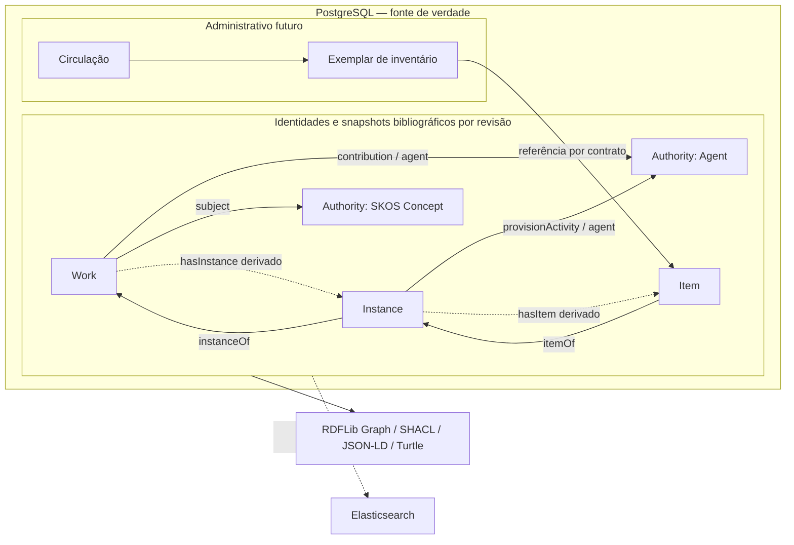

# Contrato catalográfico v1 — referência canônica

Identificador: **`urn:libris:contract:catalogographic:v1`**. Versão da
especificação documental: **1.0.0** (M03.05.02 / [issue #31](https://github.com/inacioigne/libris/issues/31)).
Baseline técnica do checkout; homologação institucional dos perfis pendente.
A superfície HTTP editorial implementada na #47 é descrita em
[catalogographic-http.md](catalogographic-http.md); este identificador não é um
header nem um campo novo dos DTOs.
`FastAPI.info.version=0.1.0`, `/api/v1`, `bibliographic_contract=1.0` dos perfis e
`contract_version=1.0` dos diagnósticos/valores são identificadores independentes;
nenhum deles foi reescrito para 1.0.0.

O objetivo é permitir consumo dos contratos existentes sem reconstruir sua definição
pela leitura integral do código. RDFLib Graph é a representação semântica canônica;
PostgreSQL é a fonte persistente, com snapshots JSON-LD expandido em JSONB.
Pydantic é a superfície tipada de aplicação, não uma segunda fonte bibliográfica.
Python 3.13–3.14, Pydantic 2, SQLAlchemy 2 async, RDFLib e pySHACL são dependências
fixadas por `apps/api/uv.lock`. Tabelas `experimental_semantic_*` são experimentais.

## Como usar a especificação

| Artefato normativo / complementar | Responsabilidade |
| --- | --- |
| Este documento | Escopo, estado atual, entidades, propriedade, revisão e limites |
| [Schemas e invariantes](catalogographic-schemas.md) | Create/Read/Update, regras cruzadas e serialização JSON |
| [Inventário de todos os campos](catalogographic-contract-field-inventory.md) / [baseline JSON Schema](catalogographic-contract-v1.schema.json) | Tipos, presença, null, cardinalidade, enums, defaults e auxiliares gerados dos 22 contratos raiz |
| [Relacionamentos](relationships.md) | Registro de relações, referências, operações e resolução interna |
| [Identificadores](persistent-identifiers.md) / [OIDC](identity.md) | Identidade bibliográfica versus identidade autenticada |
| [Serialização](semantic-serialization.md) | Cada campo Read → predicado/classe RDF, contexto, datatypes, idiomas e limites |
| [Perfis](catalog-profiles.md) / [SHACL](shacl-validation.md) / [shapes](shacl-inventory.md) | Configuração declarativa independente, releases e regras executáveis |
| [Erros](catalogographic-errors.md) | Diagnósticos, códigos, segurança, serialização e handlers HTTP |
| [Superfície HTTP M05.01](catalogographic-http.md) | POST/GET/PATCH persistentes #47, dependências, precondições e operações futuras |
| [Valores controlados](controlled-vocabularies.md) / [extensões](semantic-extensions.md) | Contratos aditivos; não acrescentam campos aos DTOs históricos |
| [Editorial](editorial-lifecycle.md) / [persistência editorial](editorial-persistence.md) / [auditoria](provenance-audit-versioning.md) | Serviços internos, permissões e estado persistente independente |
| [Política de evolução](../decisions/0029-catalogographic-contract-versioning.md) | Política proposta de governança; SemVer documental e compatibilidade direcional |
| [Rastreabilidade](catalogographic-contract-traceability.md) / [verificação #31](catalogographic-contract-v1-verification.md) | Implementadores, asserções concretas, cobertura e execução desta baseline |

Os ADRs registram decisões no momento de cada entrega; os relatórios `*-verification.md`
registram execuções históricas, não resultados desta sessão. Em divergência, usar o
comportamento verificável da baseline e registrar a lacuna antes de qualquer alteração
incompatível. A descrição do Incremento 1 abaixo foi preservada e atualizada apenas
onde o estado atual já é demonstrável.

A M04.05 explicita o [contexto e guard de aplicação](operation-authorization.md).
Nas assinaturas internas abaixo, `actor=` autenticado é adaptador de compatibilidade;
ausência de ator exige `context=` técnico/humano explícito, sem fallback de autorização.
`read` é editorial autorizado; público continua usando `read_public`. DTOs, snapshots,
CAS e especificação catalográfica v1 permanecem compatíveis.

## Superfícies implementadas e operações

| Nível | Entrada → saída | Pré-condições / erros / limites |
| --- | --- | --- |
| Contratos públicos Python | Work, Instance, Item, Agent e Subject: Create/Read/Update | Quinze modelos em `api/schemas`; Create sem UUID/URI; Read acrescenta ambos, sem revisão/ator; Update parcial não persiste |
| Contratos de vínculos | RelationshipCreate/Read/Replace/Update | Estado completo ou operações add/remove/replace; Read admite inversas compostas; operações puras revalidam o estado final |
| Contratos auxiliares públicos | CatalogValidationResult, CatalogValueDocument, ProblemDetails | Diagnóstico 1.0, valor discriminado 1.0, envelope HTTP; não são entidades bibliográficas |
| Serviço interno `BibliographicService.create` | ResourceIdentity + Graph + Provenance + profile + ator opcional → Revision r1 | Perfil legado default; somente três IDs históricos; valida antes de abrir transação; cria snapshot, estado draft e evento created no mesmo commit |
| Serviço interno `revise` | UUID + expected_revision + Graph completo + Provenance + ator opcional; expected_editorial_version opcional → Revision rN+1 | Revisão positiva obrigatória, URI e perfil armazenados reutilizados; tipo institucional preservado; CAS, validação, revisão, estado e evento revised atômicos; stale/rejeição/falha revertem tudo |
| Serviço interno `read` | UUID + number opcional → (Revision, Graph) | Sem número lê corrente; histórico proprietário; ResourceNotFoundError se ausente; contexto confiável e guard editorial M04.05 |
| Serviço interno `read_public` | UUID → (Revision, Graph) ou None | Lê revisão publicada exata; None para ausência de publicação/metadados legados, não presume publicação da corrente |
| Serviço interno `restore_content` | UUID + source_revision + expected_revision + Provenance + actor autenticado; versão editorial opcional → Revision rN+1 | Permissões metadata_revision:read/create; revalida histórico; conserva origem histórica intacta; registra restored/content; não publica automaticamente |
| Serviços internos `HistoryService` / `EditorialService` | Histórico/paginação/comparação e transition com expectativas de versão/conteúdo → visões/estado editorial | Autorização explícita; `PostgresEditorialTransactions` controla transação, validação e integridade local na publicação; ver contratos complementares |
| Endpoints reais | GET `/health`, GET `/api/v1/identity/me`; POST/GET/PATCH dos cinco tipos em `/api/v1/catalog` | OpenAPI dos handlers reais; GET editorial autenticado, PATCH If-Match; sem prevalidate/perfis/resolver HTTP |
| Composição HTTP M05.01 / #45 | APIRouter `/api/v1/catalog` integrado em create_app; acesso à fábrica de sessões do lifespan | Sem endpoints artificiais; identidade/guard/correlação existentes reutilizados; [matriz HTTP e permissões](catalogographic-http.md), implementação de operações nas #46–#51 |

A M05.02 acrescenta os [adaptadores internos DTO ↔ RDF](catalogographic-dto-rdf-adapters.md):
`create_to_graph`, `graph_to_read` e `apply_update`, reutilizando o writer Read existente.
O PATCH transforma uma cópia do snapshot completo e valida antes de retornar, sem
apagar propriedades independentes fora do DTO. A projeção Read tem limites explícitos;
exportação integral continua usando Graph. A #47 conecta esses adaptadores ao PATCH editorial autenticado.
`expected_revision` permanece argumento de `revise`, fora dos DTOs; CAS, transações,
auditoria e revisão imutável continuam nos serviços atuais. Erros de domínio não têm
status HTTP intrínseco: os handlers os traduzem somente quando chegam a uma requisição.

## Formatos e exemplos verificáveis

JSON de aplicação usa snake_case, UUID em string, referências sem descrição embutida,
listas vazias em Create/Read, extras rejeitados e `exclude_unset=True` em Update.
JSON-LD/Turtle são saídas do mesmo Graph; o contexto local `bibframe-v1` é fixado e
não é baixado. Os prefixos bf, rdf, rdfs, xsd, skos, dcterms e prov são aliases de
IRIs completas, nunca identificadores alternativos. Idiomas/datatype/literais
seguem a [tabela de mapeamento](semantic-serialization.md#mapeamento-completo-da-superfície-read).
O isomorfismo RDF define equivalência, sem prometer ordem, bytes ou labels de BNodes.
Entrada passa por adaptador limitado: default 1 MiB, máximo configurável 10 MiB,
profundidade JSON 64; não resolver contextos/imports externos. RDF/XML, N-Triples e
Dataset não pertencem a esta superfície. Lexicais que RDFLib não conserva geram
erro explícito de exportação; não há garantia de round-trip textual.

| Necessidade | Artefato existente / verificação |
| --- | --- |
| Cinco entidades, Create/Read/Update | `tests/fixtures/bibliographic/contracts/{work,instance,item,agent,subject}-{create,read,update}.json`; quinze exemplos em [schemas](catalogographic-schemas.md#exemplos-json) |
| JSON, JSON-LD e Turtle pareados; autoridades e composição | [examples/serialization](../examples/serialization/README.md); `test_paired_examples_are_executable` e pipeline de `test_catalogographic_conformance.py` |
| Referências e operações válidas/inválidas | `tests/fixtures/bibliographic/relationships/manifest.json`; `test_versioned_examples` verifica modelo/camada de rejeição |
| Valores controlados | [local](../examples/controlled-vocabularies/local.json) e [externo](../examples/controlled-vocabularies/external.json), com pares RDF |
| Perfis e SHACL | [perfil resolvido](../examples/profiles/monograph-2.0.0.resolved.json), corpus institucional com manifest e inventário SHACL |
| Payload inválido e erro esperado | [erro estrutural](../examples/validation/schema-error.json), [violações](../examples/validation/violations.json), [falha técnica](../examples/validation/operational-failure.json); exemplos gerados por adaptadores reais |

Exemplo inválido verificável: `WorkCreate` com `{"title":[]}` é rejeitado por
Pydantic (cardinalidade); `WorkUpdate` com `{"title":null}` é rejeitado pelo
validador de propriedade obrigatória, enquanto `{"subject":null}` indica remoção.
Não inferir um código HTTP a partir do texto da exceção. A adaptação estrutural
gera diagnósticos schema e o handler HTTP 422; esses exemplos podem ser enviados às rotas tipadas da #47.

## Quatro dimensões de versão e compatibilidade

| Dimensão | Identidade / versão real | Regra |
| --- | --- | --- |
| Contrato público | Este ID v1; baseline documental 1.0.0; perfis declaram bibliographic_contract=1.0 | Versiona significado e superfície; não gera mecanismo HTTP de seleção |
| Perfis declarativos | format_version=2.0; família, release_id e release (ex.: monograph 2.0.0) | Entrada/resolução e regras próprias; candidatos não homologados; legado preservado |
| Shapes SHACL | experimental 1.0 / institutional 1.1, contexto snapshot/composed | Seleção local explícita; authority perfil 1.0 usa shapes institutional 1.1 |
| Revisões de registros | Revision.number positivo por UUID; versão editorial separada | Append-only; CAS; não significa versão de API, edição bibliográfica ou release de perfil |

Política documental: correção editorial sem mudar o comportamento é patch; nova
capacidade preservando produtores **e leitores** anteriores pode ser minor;
remoção, novo obrigatório, mudança de tipo, cardinalidade ou semântica que rompe
qualquer direção exige major. Como os DTOs usam `extra=forbid`, campo opcional novo
aceito pelo produtor novo não é automaticamente compatível com um leitor antigo.
Não enviar tal campo a consumidores antigos sem superfície/seleção explícita.
Enums/códigos também requerem exame do leitor: Diagnostic.code é enum fechado,
apesar da recomendação de fallback dos consumidores de UI.
O [ADR 0029 proposto](../decisions/0029-catalogographic-contract-versioning.md)
detalha avaliação direcional, descontinuação, coexistência e migração; sua aprovação
de governança é pendente, sem alegar decisão institucional já tomada.

O gerador só escreve esta baseline ausente ou idêntica; `--check` detecta divergência.
Versões futuras devem preservar este artefato e introduzir novo ID/arquivo após
revisão explícita. Não sobrescrever baseline nem atualizar hashes históricos para
acomodar mudança de comportamento. A seleção da versão pública futura não existe;
nenhuma migração, header, roteador ou infraestrutura foi introduzido na #31.

## Limitações e pendências atuais

Conformidade técnica é execução correta do software; conformidade semântica é
satisfazer as regras efetivamente modeladas; homologação institucional é decisão
dos responsáveis biblioteconômicos. Os testes não substituem essa decisão.

- POST/GET/PATCH editoriais estão implementados na #47; não há editor, prevalidate,
  resolução HTTP, tombstones persistidos,
  fusão operacional, SPARQL, MARC, conectores remotos ou projeção Elasticsearch.
- O serviço de escrita ainda aceita somente perfis históricos; perfis 2.0 são
  resolvidos/validados internamente sem migração automática de registros.
- Integridade local é verificada na publicação editorial transacional; isso não
  implica verificação universal em create/revise nem existência de alvos externos.
- DTOs e SHACL não são equivalentes: DTO limita uma forma sem idioma e Item exige
  Local; SHACL uniqueLang não limita strings sem idioma e perfil declarativo core
  não lista toda alternativa histórica de identifiedBy. Essas diferenças são
  explícitas, sem relaxamento unilateral.
- Dados fora dos campos DTO exigem exportação integral do Graph. Vocabulários e
  extensões aditivos não tornam DTOs históricos genéricos. ISBN não tem checksum;
  tipo/identidade externa não são provados por IRI sintaticamente válida.
- Perfis, tradução, títulos, identificadores de Item, vocabulários, domínio público,
  retenção/visibilidade histórica e política de fusão aguardam decisão institucional.
- Atomicidade física depende de PostgreSQL real e migrações explícitas; testes
  com doubles não comprovam a garantia do banco. Evidência desta sessão e limites
  estão na [verificação #31](catalogographic-contract-v1-verification.md).

## Perfil institucional do Incremento 1 (preservado)

Release candidata institucional: **monograph-v1, release 1.1**,
`urn:libris:profile:monograph:v1:1`. Perfil complementar de autoridades:
`urn:libris:profile:authority:v1`, release 1.0. Implementação técnica autorizada
após o diagnóstico; homologação institucional e avaliação com catalogadores
continuam pendentes. Estes artefatos não definem esquema bibliográfico definitivo.

Os [contratos públicos Pydantic](catalogographic-schemas.md) da M03.01.02
representam os campos proprietários destes perfis, sem alterar o RDF canônico.

A evolução configurável da #20 está em [perfis declarativos 2.0](catalog-profiles.md)
e [ADR 0021](../decisions/0021-declarative-catalog-profiles.md), com adaptação explícita
sem reescrever os artefatos descritos abaixo.

## Artefatos e compatibilidade

- `apps/api/src/libris/modules/bibliographic/resources/monograph-v1.json` e `.ttl`
  são a release experimental legada; permanecem intactos, com seu identificador.
- `monograph-v1.1.json` e `.ttl` contêm a candidata institucional. O JSON descreve
  formulários; SHACL é autoridade para conformidade do RDF. O modo composto usa
  também `monograph-v1.1-composed.ttl` para conferir inversas.
- `authority-v1.json` e `.ttl` descrevem autoridades reutilizáveis, sem implementar
  um novo módulo/serviço de autoridades ou reconciliação externa.
- `catalog-profile.schema.json` é o JSON Schema local gerado por
  `domain/profiles.py`, com estrutura e tipos para descritores de formulário.
  Pydantic também verifica coerência de cardinalidades, repetibilidade e ausência;
  tais invariantes cruzadas não são todas expressas pelo JSON Schema.
- `tests/fixtures/bibliographic/institutional/manifest.json` identifica dez casos
  válidos e casos deliberadamente inválidos. Todos são sintéticos; nomes, ISBNs
  e identificadores externos não afirmam registros/autoridades reais.

Não substituir arquivos de uma release publicada. Alterações posteriores de
regras, inclusive correções incompatíveis, recebem novos artefatos e ID de release.
Revisões guardam exatamente o perfil usado. Nenhum dado existente é convertido.
A assinatura existente de `create` mantém o perfil legado como default; o chamador
deve indicar explicitamente a release institucional ou a de autoridades. `revise`
reutiliza o perfil persistido e não oferece migração implícita.

Para adotar o novo contrato em um agregado antigo: planejar transformação explícita,
preservar histórico original, mapear identidades e afirmar propriedade dos nós,
validar as entidades resultantes e registrar origem/revisão da transformação.
Não executar divisão automática ou gravar cópias sobrepostas de uma autoridade.

## Entidades, propriedade e relacionamentos

Work representa criação intelectual, títulos, idioma, assuntos, contribuições e
relações entre obras. Pode existir sem manifestações. Instance representa edição,
publicação, ISBN, extensão e suporte. Item representa exemplar bibliográfico,
identificação local, instituição detentora, notas e proveniência próprias.

Cada entidade persistente tem UUID e URI próprios. Pessoas/organizações controladas
usam `bf:Agent`, `bf:Person` ou `bf:Organization`; conceitos usam `skos:Concept`.
Authority é responsabilidade institucional, não uma classe RDF criada artificialmente.
Metadados da autoridade são revisados em seu snapshot; obras guardam referências.

O snapshot tem uma raiz e sua descrição, com nós auxiliares privados. Estes podem
ser blank nodes locais ao grafo ou IRIs sob `{uri-da-raiz}#fragmento`. Essa convenção
é para auxiliares: a URI de entidade não admite fragmentos. Entidades persistentes
relacionadas não têm sua descrição incluída no snapshot proprietário. Nós órfãos,
segunda raiz, tipo incompatível e inversas gravadas são rejeitados. O contrato é
aberto a outras ontologias e propriedades; não reduz RDF a campos JSON escalares.

As relações canônicas são `Instance bf:instanceOf Work` e `Item bf:itemOf Instance`.
`bf:hasInstance` e `bf:hasItem` são derivadas na composição, sem revisão em cascata
do pai. Mudar o vínculo revisa a entidade que o possui. No perfil de monografia,
Instance tem exatamente uma Work e Item exatamente uma Instance; isso é escolha
institucional deste perfil, não cardinalidade universal de BIBFRAME.

`Work bf:contribution Contribution` mantém o nó de contribuição, um agente por URI
e um ou mais papéis por URI. `bf:subject` referencia conceito controlado ou URI
externa. `bf:provisionActivity` mantém atividade de publicação, agentes, lugar e
data na Instance. Os nós de Title/Identifier/Publication/Note não têm revisões
independentes: integram a revisão de sua entidade proprietária.

Blank nodes de grafos diferentes são renomeados ao compor; coincidência de rótulos
de serialização não significa identidade. Composição rejeita duas revisões da mesma
raiz e preserva termos RDF. A função não modifica os snapshots fornecidos.

## Validação e referências

`validate_monograph` preserva a validação legada. `validate_profile` carrega apenas
releases locais conhecidas; não aceita paths, shapes ou imports fornecidos nos dados.
Inferência, regras avançadas, JavaScript e downloads seguem desabilitados.

Validação de snapshot confere descrição proprietária e estruturas auxiliares, sem
exigir que a autoridade/Work/Instance referenciada esteja descrita no mesmo grafo.
Quando uma referência tem tipo no grafo composto, as shapes conferem sua classe.
O modo `composed=True` também exige igualdade entre relações diretas e inversas.
Um grafo com referências externas pode ser conforme sem existir uma descrição local
dessas referências; conformidade SHACL não prova existência no PostgreSQL.

Integridade de referências locais na publicação editorial está implementada pela
#43; ver [persistência editorial](editorial-persistence.md). Tratamento de recursos
descontinuados e integração pública de troca de vínculos continuam futuros. Não adicionar
tipos fictícios às referências para satisfazer shapes, nem consultar URIs na rede.
Alvos SHACL não substituem a exigência de raiz: um grafo vazio pode ter conformidade
vazia, mas não pode ser persistido como entidade.

## Regras catalográficas

Work requer ao menos um título não variante. Títulos alternativos usam
`bf:VariantTitle` via `bf:title`; `bf:mainTitle` conserva idioma e exige literal
textual não vazio, no máximo um por idioma em cada nó. Título de Instance é opcional;
ausência não grava cópia do título de Work. Interfaces futuras podem apresentá-lo
por composição, deixando clara sua origem.

Item exige ao menos um `bf:Local` com `rdf:value` textual não vazio. Outros
identificadores podem coexistir. Barcode ou número de inventário são atributos;
nunca substituem o UUID ou a URI. `bf:heldBy` é referência opcional à instituição.
Notas estruturadas usam `bf:Note`/`rdfs:label`; histórico de custódia pode usar
`bf:custodialHistory` e fontes semânticas `prov:wasDerivedFrom`.

ISBN é opcional, pertence à Instance e usa `bf:Isbn`/`rdf:value`. Esta release
verifica estrutura, cardinalidade e valor textual não vazio; não afirma checksum
correto nem registro em agência ISBN. ISBN transcrito inválido deve ser mantido
com indicação de situação/nota em política posterior, sem corrigir ou descartar
automaticamente a informação. Edição bibliográfica é `bf:editionStatement` na
Instance, distinta do número de revisão de metadados.

Datas de publicação admitem `xsd:gYear`, `xsd:date` ou `xsd:string` transcrito,
preservando incerteza; inteiro genérico não representa data no perfil. Extensão,
classificação e publicação são estruturas RDF, não strings indiferenciadas.
Campos textuais conservam idioma quando aplicável. Valores opcionais ausentes
omitem triplas; valores obrigatórios ausentes produzem violação. Não preencher
strings vazias, idioma presumido ou autoridades fictícias.

Formas autorizadas de agentes usam `rdfs:label`, uma por idioma; variantes usam
`skos:altLabel`. Conceitos exigem `skos:prefLabel`, um por idioma e disjunto de
`skos:altLabel`, e `skos:inScheme`. Relações de conceitos usam `skos:broader` e
`skos:related`; relações de autoridades podem usar `dcterms:relation`.

URIs VIAF/ORCID/ISNI/Wikidata podem aparecer em `rdfs:seeAlso`; identificadores
externos estruturados usam valor e fonte. Link externo não implica equivalência.
`owl:sameAs` exige equivalência comprovada, proveniência e revisão humana; não é
gerado pelo serviço. Termos de vocabulários indicados no perfil orientam o formulário
e a catalogação, mas a pertença efetiva a um vocabulário não é consultada na rede.

Tradução é Work com idioma, contribuição de tradutor (`relators/trl`) e
`bf:translationOf` para a Work original. As manifestações das duas Works têm suas
edições/publicações/ISBNs. A regra é candidata à homologação catalográfica; não
confundir mudança de idioma com simples revisão administrativa de uma Instance.

## Persistência, metadados e ciclo de vida

| Informação do contrato | Fonte de verdade ou estado atual |
| --- | --- |
| UUID e URI | `experimental_semantic_resources.id/uri` |
| Revisão atual | `current_revision`, protegida por FK diferida e CAS |
| Tipo semântico | `rdf:type` da raiz no snapshot canônico; serviço preserva entre revisões institucionais |
| Criação e última alteração | `created_at` da revisão 1 e da revisão atual, em UTC |
| Histórico e conteúdo RDF | `experimental_semantic_revisions`, JSON-LD expandido em JSONB, append-only |
| Proveniência técnica e release | `source`, `process`, `profile` por revisão |
| Proveniência semântica | RDF da entidade, quando fornecida |
| Estado ativo/descontinuado/fundido/substituído | Política especificada abaixo; armazenamento/operações futuros, ainda não implementados |
| Ator humano e autorização | OIDC, actor_id opcional, auditoria interna e CRUD editorial #47; sem usuário fictício ou backfill |
| Inventário, reservas, empréstimos, multas | Módulos administrativos futuros, referenciando identidade persistente de Item |

O mesmo PostgreSQL contém identidade, controle transacional e RDF. RDFLib não é
um segundo store gravável. Avanço CAS e snapshot acontecem no mesmo commit;
falha em validação, serialização ou inserção causa rollback. Rejeição obsoleta
não sobrescreve alterações. Histórico não sofre UPDATE/DELETE por DML normal.
O Incremento 1 não criou novas tabelas/migrações. As entregas posteriores adicionaram
ator, auditoria e estado editorial (0002–0004), sem esquema bibliográfico definitivo.

Alterar Authority, Instance ou Item não altera automaticamente Work. Circulação
não modifica o grafo bibliográfico como estado primário nem revisa Item. Um
exemplar administrativo tem identidade própria e referencia Item/Instance por
contratos; módulos não acessam tabelas de outro domínio.

Não há outbox ou publicação de eventos agora. Ao surgir uma projeção, gravar evento
com event_id, entidade e revisão no commit PostgreSQL; consumir idempotentemente,
registrar tentativas e reconstruir a projeção a partir da fonte canônica.
Elasticsearch continuará reconstruível; não há transações distribuídas ou escrita
dupla. Recuperação atual utiliza atomicidade PostgreSQL e histórico; backups e
políticas operacionais não foram implementados neste incremento.

## Concorrência e representações históricas

`Revision.concurrency_token` expressa `{uuid}:r{revisão}` e está vinculado à entidade.
`require_revision_token` confere igualdade exata e rejeita token de outra entidade,
obsoleto ou curinga. É um token de domínio; não é um ETag HTTP de todos os formatos.
O serviço continua exigindo `expected_revision` e usando CAS PostgreSQL.

Na API editorial #47, ausência de If-Match em PATCH responde 428;
precondição obsoleta responde 412. A representação de edição usa ETag forte próprio,
com identidade/revisão, perfil, versão editorial e projeção JSON versionada;
ver [protocolo operacional](catalogographic-http.md).
Não aceitar validador fraco ou `*` como substituto da revisão esperada. Se o ETag
encapsular formato/hash, o adaptador HTTP deverá verificá-los antes de traduzir
a precondição para a revisão, sem comparar cegamente com o token de domínio.

JSON-LD, Turtle e interface/composição possuem bytes/dependências diferentes:
seus ETags de cache também são diferentes. Mudança em autoridade ou novos filhos
altera composição/inversas sem necessariamente alterar revisão de Work. ETag
de composição deve refletir essas dependências. Não prometer estabilidade de
blank-node labels ou ordem de serialização; a fidelidade RDF usa isomorfismo.

`read(id, number)` retorna apenas o snapshot proprietário daquela revisão.
Composição histórica requer escolha explícita das revisões relacionadas ou um
corte temporal documentado; não combina silenciosamente autoridade atual com
afirmações históricas como se fosse uma revisão global. Named graphs físicos
ficam adiados: a chave recurso+revisão já identifica o snapshot, sem mudar a URI
da entidade ou acrescentar Dataset ao adaptador.

## Política institucional de URIs e HTTP futuro

A forma é `{RESOURCE_BASE_URI}/{uuid}`, atualmente `/resources/{uuid}`. O UUID é
opaco e aleatório; tipo, título, idioma, ISBN, barcode e localização não participam
da identidade. URI é materializada na criação e reutilizada nas revisões. Trocar
a base de ambiente não reescreve identidades existentes. Não reutilizar UUIDs
descontinuados/excluídos; tombstones deverão reservar a identidade indefinidamente.
Domínio público e políticas de publicação ainda precisam de escolha institucional.

| Situação/solicitação | Comportamento contratado para o Incremento 2 |
| --- | --- |
| Identidade ativa, Accept JSON-LD | 303 para documento JSON-LD; documento 200, `application/ld+json` |
| Identidade ativa, Accept Turtle | 303 para documento Turtle; documento 200, `text/turtle` |
| Identidade ativa, Accept HTML | 303 para URL da interface; HTML 200 |
| Sem Accept ou `*/*` | Preferir JSON-LD; aceitar negociação por qualidade/especificidade, ignorando q=0 |
| Accept sem representação disponível | 406; não retornar HTML silenciosamente |
| Resposta negociada | `Vary: Accept`; informar URI canônica e tipo correto na representação |
| UUID desconhecido | 404, sem inventar tombstone |
| Descontinuado sem sucessor equivalente | 410, informação de estado e acesso ao histórico conforme permissão |
| Fusão comprovada | 308 da identidade anterior para sobrevivente; manter tombstone, motivo e histórico; impedir ciclos |
| Substituição sem equivalência | Não tratar como fusão; manter estado/histórico e relação explícita com sucessor; identidade antiga responde 410 se descontinuada |
| Revisão inexistente | 404; URI da entidade continua a mesma |

As URLs concretas de documentos/interface e o suporte completo a negociação serão
definidos na API; este incremento não cria resolver HTTP. Não redirecionar para
uma URI externa por simples `seeAlso` ou identificador. Mudanças de domínio exigem
preservação/redirecionamento da base antiga e plano explícito; não derivar novas
URIs para registros já existentes a cada leitura.

## Diagrama de entidades e fronteiras



## Uso interno e inspeção

```python
from libris.modules.bibliographic.infrastructure.validation import INSTITUTIONAL_PROFILE_ID

# Dentro de função async, graph contém somente a entidade e seus auxiliares.
# context é obtido do OIDC validado ou do composition root técnico confiável.
# await service.create(identity, graph, provenance, profile=INSTITUTIONAL_PROFILE_ID,
#                      context=context)
# await service.revise(identity.internal_id, expected_revision=1,
#                      graph=updated_graph, provenance=provenance, context=context)
```

Da pasta `apps/api`, inspeção sem gravação:

```bash
uv run python -m libris.modules.bibliographic \
  ../../tests/fixtures/bibliographic/institutional/two-editions.ttl \
  --profile urn:libris:profile:monograph:v1:1
```

A fixture contém relações diretas canônicas. Para `--composed`, fornecer um grafo
composto com inversas; o CLI valida, não corrige divergências. A #47 conecta os
serviços às rotas POST/GET/PATCH editoriais, sem formulários Next.js.

## Referências e decisões

Modelagem baseada na [ontologia oficial BIBFRAME da Library of Congress](https://github.com/lcnetdev/bibframe-ontology/blob/master/bibframe.rdf)
e nas regras de rótulos de [SKOS Reference](https://www.w3.org/TR/skos-reference/).
As cardinalidades e o tratamento institucional de traduções são escolhas deste
contrato, sujeitas à homologação, e não afirmações universais da ontologia.

Ver ADRs 0009–0015 em `docs/decisions/`, o
[diagnóstico](catalogographic-contract-diagnosis.md) e o
[relatório de alterações e verificação](catalogographic-contract-verification.md).


## Matriz de campos por proprietário

Esta matriz acompanha os JSONs versionados. `1..*` é obrigatório e repetível;
`0..*` é opcional e repetível; `1..1` é obrigatório e não repetível. Ausência
obrigatória viola SHACL; ausência opcional omite a tripla. Tipo literal sempre
exige valor não vazio. `IRI` é referência; `BlankNodeOrIRI` é estrutura auxiliar
privada quando há descrição. Regras adicionais constam na coluna de validação.
Os vocabulários informados são sugestões controladas para formulários; não são
consultados remotamente. O campo marcado derivado não integra escrita do snapshot.

### Monografia institucional — candidato 1.1

Proprietário: **Obra** (`bf:Work`).

| Nome funcional | Propriedade RDF | Valor / idioma | Cardinalidade | Destino / vocabulário | Validação |
| --- | --- | --- | --- | --- | --- |
| Títulos principal e alternativos | `bf:title` | BlankNodeOrIRI | 1..* | bf:Title, bf:VariantTitle | Ao menos um título não variante; um mainTitle por idioma em cada nó. |
| Idioma | `bf:language` | IRI | 0..* |  http://id.loc.gov/vocabulary/languages/ | Referência RDF explícita; sem resolução remota. |
| Conteúdo | `bf:content` | IRI | 0..* |  http://id.loc.gov/vocabulary/contentTypes/ | Referência RDF explícita; sem resolução remota. |
| Contribuições | `bf:contribution` | BlankNodeOrIRI | 0..* | bf:Contribution | Referência RDF explícita; sem resolução remota. |
| Assuntos | `bf:subject` | IRI | 0..* | skos:Concept | Referência RDF explícita; sem resolução remota. |
| Classificação | `bf:classification` | BlankNodeOrIRI | 0..* | bf:Classification | Referência RDF explícita; sem resolução remota. |
| Obras relacionadas | `bf:relatedTo` | IRI | 0..* | bf:Work | Referência RDF explícita; sem resolução remota. |
| Tradução de | `bf:translationOf` | IRI | 0..* | bf:Work | Referência RDF explícita; sem resolução remota. |
| Manifestações | `bf:hasInstance` | IRI | 0..* | bf:Instance | Derivado. Derivada de instanceOf; não gravar no snapshot proprietário. |
| Notas | `bf:note` | BlankNodeOrIRI | 0..* | bf:Note | Referência RDF explícita; sem resolução remota. |

Proprietário: **Manifestação** (`bf:Instance`).

| Nome funcional | Propriedade RDF | Valor / idioma | Cardinalidade | Destino / vocabulário | Validação |
| --- | --- | --- | --- | --- | --- |
| Título | `bf:title` | BlankNodeOrIRI | 0..* | bf:Title, bf:VariantTitle | Referência RDF explícita; sem resolução remota. |
| Indicação de edição | `bf:editionStatement` | Literal: xsd:string, rdf:langString; idioma preservado | 0..* | — | Literal não vazio; preservar idioma/datatype. |
| Publicação | `bf:provisionActivity` | BlankNodeOrIRI | 0..* | bf:Publication | Referência RDF explícita; sem resolução remota. |
| Identificadores | `bf:identifiedBy` | BlankNodeOrIRI | 0..* | bf:Identifier, bf:Local, bf:Isbn | Referência RDF explícita; sem resolução remota. |
| Extensão | `bf:extent` | BlankNodeOrIRI | 0..* | bf:Extent | Referência RDF explícita; sem resolução remota. |
| Suporte | `bf:carrier` | IRI | 0..* |  http://id.loc.gov/vocabulary/carriers/ | Referência RDF explícita; sem resolução remota. |
| Obra | `bf:instanceOf` | IRI | 1..1 | bf:Work | Referência RDF explícita; sem resolução remota. |
| Exemplares | `bf:hasItem` | IRI | 0..* | bf:Item | Derivado. Derivada de itemOf; não gravar no snapshot proprietário. |
| Notas | `bf:note` | BlankNodeOrIRI | 0..* | bf:Note | Referência RDF explícita; sem resolução remota. |

Proprietário: **Exemplar bibliográfico** (`bf:Item`).

| Nome funcional | Propriedade RDF | Valor / idioma | Cardinalidade | Destino / vocabulário | Validação |
| --- | --- | --- | --- | --- | --- |
| Manifestação | `bf:itemOf` | IRI | 1..1 | bf:Instance | Referência RDF explícita; sem resolução remota. |
| Identificador institucional | `bf:identifiedBy` | BlankNodeOrIRI | 1..* | bf:Identifier, bf:Local | Ao menos um bf:Local com rdf:value não vazio; barcode/inventário são atributos. |
| Instituição detentora | `bf:heldBy` | IRI | 0..* | bf:Organization | Referência RDF explícita; sem resolução remota. |
| Notas | `bf:note` | BlankNodeOrIRI | 0..* | bf:Note | Referência RDF explícita; sem resolução remota. |
| Histórico de custódia | `bf:custodialHistory` | Literal: xsd:string, rdf:langString; idioma preservado | 0..* | — | Literal não vazio; preservar idioma/datatype. |
| Informação bibliográfica de localização | `bf:itemLocation` | BlankNodeOrIRI | 0..* | — | Referência RDF explícita; sem resolução remota. |
| Proveniência semântica | `prov:wasDerivedFrom` | IRI | 0..* | — | Referência RDF explícita; sem resolução remota. |

Proprietário: **Título** (`bf:Title`).

| Nome funcional | Propriedade RDF | Valor / idioma | Cardinalidade | Destino / vocabulário | Validação |
| --- | --- | --- | --- | --- | --- |
| Título principal | `bf:mainTitle` | Literal: xsd:string, rdf:langString; idioma preservado | 1..* | — | Literal não vazio; preservar idioma/datatype. |
| Subtítulo | `bf:subtitle` | Literal: xsd:string, rdf:langString; idioma preservado | 0..* | — | Literal não vazio; preservar idioma/datatype. |

Proprietário: **Contribuição** (`bf:Contribution`).

| Nome funcional | Propriedade RDF | Valor / idioma | Cardinalidade | Destino / vocabulário | Validação |
| --- | --- | --- | --- | --- | --- |
| Agente | `bf:agent` | IRI | 1..1 | bf:Agent, bf:Person, bf:Organization | Referência RDF explícita; sem resolução remota. |
| Papel | `bf:role` | IRI | 1..* |  http://id.loc.gov/vocabulary/relators/ | Referência RDF explícita; sem resolução remota. |

Proprietário: **Publicação** (`bf:Publication`).

| Nome funcional | Propriedade RDF | Valor / idioma | Cardinalidade | Destino / vocabulário | Validação |
| --- | --- | --- | --- | --- | --- |
| Publicador | `bf:agent` | IRI | 0..* | bf:Agent, bf:Person, bf:Organization | Referência RDF explícita; sem resolução remota. |
| Local de publicação | `bf:place` | IRI | 0..* | — | Referência RDF explícita; sem resolução remota. |
| Data de publicação | `bf:date` | Literal: xsd:string, xsd:gYear, xsd:date | 0..* | — | Texto transcrito ou data/gYear bem tipados; conservar incerteza como texto. |

Proprietário: **Identificador** (`bf:Identifier`).

| Nome funcional | Propriedade RDF | Valor / idioma | Cardinalidade | Destino / vocabulário | Validação |
| --- | --- | --- | --- | --- | --- |
| Valor | `rdf:value` | Literal: xsd:string | 1..1 | — | Literal não vazio; preservar idioma/datatype. |
| Fonte | `bf:source` | IRI | 0..* | — | Referência RDF explícita; sem resolução remota. |

Proprietário: **Extensão** (`bf:Extent`).

| Nome funcional | Propriedade RDF | Valor / idioma | Cardinalidade | Destino / vocabulário | Validação |
| --- | --- | --- | --- | --- | --- |
| Descrição | `rdfs:label` | Literal: xsd:string, rdf:langString; idioma preservado | 1..* | — | Literal não vazio; preservar idioma/datatype. |

Proprietário: **Nota** (`bf:Note`).

| Nome funcional | Propriedade RDF | Valor / idioma | Cardinalidade | Destino / vocabulário | Validação |
| --- | --- | --- | --- | --- | --- |
| Texto | `rdfs:label` | Literal: xsd:string, rdf:langString; idioma preservado | 1..* | — | Literal não vazio; preservar idioma/datatype. |
| Tipo da nota | `bf:noteType` | Literal: xsd:string | 0..* | — | Literal não vazio; preservar idioma/datatype. |

Proprietário: **Classificação** (`bf:Classification`).

| Nome funcional | Propriedade RDF | Valor / idioma | Cardinalidade | Destino / vocabulário | Validação |
| --- | --- | --- | --- | --- | --- |
| Código de classificação | `bf:classificationPortion` | Literal: xsd:string | 1..* | — | Literal não vazio; preservar idioma/datatype. |
| Esquema de classificação | `bf:source` | IRI | 0..* | — | Referência RDF explícita; sem resolução remota. |

Proprietário: **Título alternativo** (`bf:VariantTitle`).

| Nome funcional | Propriedade RDF | Valor / idioma | Cardinalidade | Destino / vocabulário | Validação |
| --- | --- | --- | --- | --- | --- |
| Título principal | `bf:mainTitle` | Literal: xsd:string, rdf:langString; idioma preservado | 1..* | — | Literal não vazio; preservar idioma/datatype. |
| Subtítulo | `bf:subtitle` | Literal: xsd:string, rdf:langString; idioma preservado | 0..* | — | Literal não vazio; preservar idioma/datatype. |

Proprietário: **Identificador local** (`bf:Local`).

| Nome funcional | Propriedade RDF | Valor / idioma | Cardinalidade | Destino / vocabulário | Validação |
| --- | --- | --- | --- | --- | --- |
| Valor | `rdf:value` | Literal: xsd:string | 1..1 | — | Literal não vazio; preservar idioma/datatype. |
| Fonte | `bf:source` | IRI | 0..* | — | Referência RDF explícita; sem resolução remota. |

Proprietário: **ISBN** (`bf:Isbn`).

| Nome funcional | Propriedade RDF | Valor / idioma | Cardinalidade | Destino / vocabulário | Validação |
| --- | --- | --- | --- | --- | --- |
| Valor | `rdf:value` | Literal: xsd:string | 1..1 | — | Literal não vazio; preservar idioma/datatype. |
| Fonte | `bf:source` | IRI | 0..* | — | Referência RDF explícita; sem resolução remota. |

### Autoridades básicas — candidato 1

Proprietário: **Agente** (`bf:Agent`).

| Nome funcional | Propriedade RDF | Valor / idioma | Cardinalidade | Destino / vocabulário | Validação |
| --- | --- | --- | --- | --- | --- |
| Forma autorizada | `rdfs:label` | Literal: xsd:string, rdf:langString; idioma preservado | 1..* | — | Uma forma autorizada por idioma; preservar forma transcrita. |
| Formas variantes | `skos:altLabel` | Literal: xsd:string, rdf:langString; idioma preservado | 0..* | — | Literal não vazio; preservar idioma/datatype. |
| Identificadores | `bf:identifiedBy` | BlankNodeOrIRI | 0..* | bf:Identifier, bf:Local, bf:Isbn | Referência RDF explícita; sem resolução remota. |
| Referências externas | `rdfs:seeAlso` | IRI | 0..* | — | Referência RDF explícita; sem resolução remota. |
| Proveniência | `prov:wasDerivedFrom` | IRI | 0..* | — | Referência RDF explícita; sem resolução remota. |
| Autoridade relacionada | `dcterms:relation` | IRI | 0..* | — | Referência RDF explícita; sem resolução remota. |

Proprietário: **Pessoa** (`bf:Person`).

| Nome funcional | Propriedade RDF | Valor / idioma | Cardinalidade | Destino / vocabulário | Validação |
| --- | --- | --- | --- | --- | --- |
| Forma autorizada | `rdfs:label` | Literal: xsd:string, rdf:langString; idioma preservado | 1..* | — | Uma forma autorizada por idioma; preservar forma transcrita. |
| Formas variantes | `skos:altLabel` | Literal: xsd:string, rdf:langString; idioma preservado | 0..* | — | Literal não vazio; preservar idioma/datatype. |
| Identificadores | `bf:identifiedBy` | BlankNodeOrIRI | 0..* | bf:Identifier, bf:Local, bf:Isbn | Referência RDF explícita; sem resolução remota. |
| Referências externas | `rdfs:seeAlso` | IRI | 0..* | — | Referência RDF explícita; sem resolução remota. |
| Proveniência | `prov:wasDerivedFrom` | IRI | 0..* | — | Referência RDF explícita; sem resolução remota. |
| Autoridade relacionada | `dcterms:relation` | IRI | 0..* | — | Referência RDF explícita; sem resolução remota. |

Proprietário: **Entidade coletiva** (`bf:Organization`).

| Nome funcional | Propriedade RDF | Valor / idioma | Cardinalidade | Destino / vocabulário | Validação |
| --- | --- | --- | --- | --- | --- |
| Forma autorizada | `rdfs:label` | Literal: xsd:string, rdf:langString; idioma preservado | 1..* | — | Uma forma autorizada por idioma; preservar forma transcrita. |
| Formas variantes | `skos:altLabel` | Literal: xsd:string, rdf:langString; idioma preservado | 0..* | — | Literal não vazio; preservar idioma/datatype. |
| Identificadores | `bf:identifiedBy` | BlankNodeOrIRI | 0..* | bf:Identifier, bf:Local, bf:Isbn | Referência RDF explícita; sem resolução remota. |
| Referências externas | `rdfs:seeAlso` | IRI | 0..* | — | Referência RDF explícita; sem resolução remota. |
| Proveniência | `prov:wasDerivedFrom` | IRI | 0..* | — | Referência RDF explícita; sem resolução remota. |
| Autoridade relacionada | `dcterms:relation` | IRI | 0..* | — | Referência RDF explícita; sem resolução remota. |

Proprietário: **Conceito controlado** (`skos:Concept`).

| Nome funcional | Propriedade RDF | Valor / idioma | Cardinalidade | Destino / vocabulário | Validação |
| --- | --- | --- | --- | --- | --- |
| Termo autorizado | `skos:prefLabel` | Literal: xsd:string, rdf:langString; idioma preservado | 1..* | — | Um prefLabel por idioma; disjunto de altLabel. |
| Termos variantes | `skos:altLabel` | Literal: xsd:string, rdf:langString; idioma preservado | 0..* | — | Literal não vazio; preservar idioma/datatype. |
| Vocabulário | `skos:inScheme` | IRI | 1..* | — | Referência RDF explícita; sem resolução remota. |
| Conceito mais amplo | `skos:broader` | IRI | 0..* | — | Referência RDF explícita; sem resolução remota. |
| Conceito relacionado | `skos:related` | IRI | 0..* | — | Referência RDF explícita; sem resolução remota. |
| Referências externas | `rdfs:seeAlso` | IRI | 0..* | — | Referência RDF explícita; sem resolução remota. |
| Proveniência | `prov:wasDerivedFrom` | IRI | 0..* | — | Referência RDF explícita; sem resolução remota. |


## Matriz de campos por proprietário

Esta matriz acompanha os JSONs versionados. `1..*` é obrigatório e repetível;
`0..*` é opcional e repetível; `1..1` é obrigatório e não repetível. Ausência
obrigatória viola SHACL; ausência opcional omite a tripla. Tipo literal sempre
exige valor não vazio. `IRI` é referência; `BlankNodeOrIRI` é estrutura auxiliar
privada quando há descrição. Regras adicionais constam na coluna de validação.
Os vocabulários informados são sugestões controladas para formulários; não são
consultados remotamente. O campo marcado derivado não integra escrita do snapshot.

### Monografia institucional — candidato 1.1

Proprietário: **Obra** (`bf:Work`).

| Nome funcional | Propriedade RDF | Valor / idioma | Cardinalidade | Destino / vocabulário | Validação |
| --- | --- | --- | --- | --- | --- |
| Títulos principal e alternativos | `bf:title` | BlankNodeOrIRI | 1..* | bf:Title, bf:VariantTitle | Ao menos um título não variante; um mainTitle por idioma em cada nó. |
| Idioma | `bf:language` | IRI | 0..* |  http://id.loc.gov/vocabulary/languages/ | Referência RDF explícita; sem resolução remota. |
| Conteúdo | `bf:content` | IRI | 0..* |  http://id.loc.gov/vocabulary/contentTypes/ | Referência RDF explícita; sem resolução remota. |
| Contribuições | `bf:contribution` | BlankNodeOrIRI | 0..* | bf:Contribution | Referência RDF explícita; sem resolução remota. |
| Assuntos | `bf:subject` | IRI | 0..* | skos:Concept | Referência RDF explícita; sem resolução remota. |
| Classificação | `bf:classification` | BlankNodeOrIRI | 0..* | bf:Classification | Referência RDF explícita; sem resolução remota. |
| Obras relacionadas | `bf:relatedTo` | IRI | 0..* | bf:Work | Referência RDF explícita; sem resolução remota. |
| Tradução de | `bf:translationOf` | IRI | 0..* | bf:Work | Referência RDF explícita; sem resolução remota. |
| Manifestações | `bf:hasInstance` | IRI | 0..* | bf:Instance | Derivado. Derivada de instanceOf; não gravar no snapshot proprietário. |
| Notas | `bf:note` | BlankNodeOrIRI | 0..* | bf:Note | Referência RDF explícita; sem resolução remota. |

Proprietário: **Manifestação** (`bf:Instance`).

| Nome funcional | Propriedade RDF | Valor / idioma | Cardinalidade | Destino / vocabulário | Validação |
| --- | --- | --- | --- | --- | --- |
| Título | `bf:title` | BlankNodeOrIRI | 0..* | bf:Title, bf:VariantTitle | Referência RDF explícita; sem resolução remota. |
| Indicação de edição | `bf:editionStatement` | Literal: xsd:string, rdf:langString; idioma preservado | 0..* | — | Literal não vazio; preservar idioma/datatype. |
| Publicação | `bf:provisionActivity` | BlankNodeOrIRI | 0..* | bf:Publication | Referência RDF explícita; sem resolução remota. |
| Identificadores | `bf:identifiedBy` | BlankNodeOrIRI | 0..* | bf:Identifier, bf:Local, bf:Isbn | Referência RDF explícita; sem resolução remota. |
| Extensão | `bf:extent` | BlankNodeOrIRI | 0..* | bf:Extent | Referência RDF explícita; sem resolução remota. |
| Suporte | `bf:carrier` | IRI | 0..* |  http://id.loc.gov/vocabulary/carriers/ | Referência RDF explícita; sem resolução remota. |
| Obra | `bf:instanceOf` | IRI | 1..1 | bf:Work | Referência RDF explícita; sem resolução remota. |
| Exemplares | `bf:hasItem` | IRI | 0..* | bf:Item | Derivado. Derivada de itemOf; não gravar no snapshot proprietário. |
| Notas | `bf:note` | BlankNodeOrIRI | 0..* | bf:Note | Referência RDF explícita; sem resolução remota. |

Proprietário: **Exemplar bibliográfico** (`bf:Item`).

| Nome funcional | Propriedade RDF | Valor / idioma | Cardinalidade | Destino / vocabulário | Validação |
| --- | --- | --- | --- | --- | --- |
| Manifestação | `bf:itemOf` | IRI | 1..1 | bf:Instance | Referência RDF explícita; sem resolução remota. |
| Identificador institucional | `bf:identifiedBy` | BlankNodeOrIRI | 1..* | bf:Identifier, bf:Local | Ao menos um bf:Local com rdf:value não vazio; barcode/inventário são atributos. |
| Instituição detentora | `bf:heldBy` | IRI | 0..* | bf:Organization | Referência RDF explícita; sem resolução remota. |
| Notas | `bf:note` | BlankNodeOrIRI | 0..* | bf:Note | Referência RDF explícita; sem resolução remota. |
| Histórico de custódia | `bf:custodialHistory` | Literal: xsd:string, rdf:langString; idioma preservado | 0..* | — | Literal não vazio; preservar idioma/datatype. |
| Marca de estante bibliográfica | `bf:shelfMark` | BlankNodeOrIRI | 0..* | bf:ShelfMark | Referência RDF explícita; sem resolução remota. |
| Proveniência semântica | `prov:wasDerivedFrom` | IRI | 0..* | — | Referência RDF explícita; sem resolução remota. |

Proprietário: **Título** (`bf:Title`).

| Nome funcional | Propriedade RDF | Valor / idioma | Cardinalidade | Destino / vocabulário | Validação |
| --- | --- | --- | --- | --- | --- |
| Título principal | `bf:mainTitle` | Literal: xsd:string, rdf:langString; idioma preservado | 1..* | — | Literal não vazio; preservar idioma/datatype. |
| Subtítulo | `bf:subtitle` | Literal: xsd:string, rdf:langString; idioma preservado | 0..* | — | Literal não vazio; preservar idioma/datatype. |

Proprietário: **Contribuição** (`bf:Contribution`).

| Nome funcional | Propriedade RDF | Valor / idioma | Cardinalidade | Destino / vocabulário | Validação |
| --- | --- | --- | --- | --- | --- |
| Agente | `bf:agent` | IRI | 1..1 | bf:Agent, bf:Person, bf:Organization | Referência RDF explícita; sem resolução remota. |
| Papel | `bf:role` | IRI | 1..* |  http://id.loc.gov/vocabulary/relators/ | Referência RDF explícita; sem resolução remota. |

Proprietário: **Publicação** (`bf:Publication`).

| Nome funcional | Propriedade RDF | Valor / idioma | Cardinalidade | Destino / vocabulário | Validação |
| --- | --- | --- | --- | --- | --- |
| Publicador | `bf:agent` | IRI | 0..* | bf:Agent, bf:Person, bf:Organization | Referência RDF explícita; sem resolução remota. |
| Local de publicação | `bf:place` | IRI | 0..* | — | Referência RDF explícita; sem resolução remota. |
| Data de publicação | `bf:date` | Literal: xsd:string, xsd:gYear, xsd:date | 0..* | — | Texto transcrito ou data/gYear bem tipados; conservar incerteza como texto. |

Proprietário: **Identificador** (`bf:Identifier`).

| Nome funcional | Propriedade RDF | Valor / idioma | Cardinalidade | Destino / vocabulário | Validação |
| --- | --- | --- | --- | --- | --- |
| Valor | `rdf:value` | Literal: xsd:string | 1..1 | — | Literal não vazio; preservar idioma/datatype. |
| Fonte | `bf:source` | IRI | 0..* | — | Referência RDF explícita; sem resolução remota. |

Proprietário: **Extensão** (`bf:Extent`).

| Nome funcional | Propriedade RDF | Valor / idioma | Cardinalidade | Destino / vocabulário | Validação |
| --- | --- | --- | --- | --- | --- |
| Descrição | `rdfs:label` | Literal: xsd:string, rdf:langString; idioma preservado | 1..* | — | Literal não vazio; preservar idioma/datatype. |

Proprietário: **Nota** (`bf:Note`).

| Nome funcional | Propriedade RDF | Valor / idioma | Cardinalidade | Destino / vocabulário | Validação |
| --- | --- | --- | --- | --- | --- |
| Texto | `rdfs:label` | Literal: xsd:string, rdf:langString; idioma preservado | 1..* | — | Literal não vazio; preservar idioma/datatype. |
| Tipo da nota | `bf:noteType` | Literal: xsd:string | 0..* | — | Literal não vazio; preservar idioma/datatype. |

Proprietário: **Classificação** (`bf:Classification`).

| Nome funcional | Propriedade RDF | Valor / idioma | Cardinalidade | Destino / vocabulário | Validação |
| --- | --- | --- | --- | --- | --- |
| Código de classificação | `bf:classificationPortion` | Literal: xsd:string | 1..* | — | Literal não vazio; preservar idioma/datatype. |
| Esquema de classificação | `bf:source` | IRI | 0..* | — | Referência RDF explícita; sem resolução remota. |

Proprietário: **Título alternativo** (`bf:VariantTitle`).

| Nome funcional | Propriedade RDF | Valor / idioma | Cardinalidade | Destino / vocabulário | Validação |
| --- | --- | --- | --- | --- | --- |
| Título principal | `bf:mainTitle` | Literal: xsd:string, rdf:langString; idioma preservado | 1..* | — | Literal não vazio; preservar idioma/datatype. |
| Subtítulo | `bf:subtitle` | Literal: xsd:string, rdf:langString; idioma preservado | 0..* | — | Literal não vazio; preservar idioma/datatype. |

Proprietário: **Identificador local** (`bf:Local`).

| Nome funcional | Propriedade RDF | Valor / idioma | Cardinalidade | Destino / vocabulário | Validação |
| --- | --- | --- | --- | --- | --- |
| Valor | `rdf:value` | Literal: xsd:string | 1..1 | — | Literal não vazio; preservar idioma/datatype. |
| Fonte | `bf:source` | IRI | 0..* | — | Referência RDF explícita; sem resolução remota. |

Proprietário: **ISBN** (`bf:Isbn`).

| Nome funcional | Propriedade RDF | Valor / idioma | Cardinalidade | Destino / vocabulário | Validação |
| --- | --- | --- | --- | --- | --- |
| Valor | `rdf:value` | Literal: xsd:string | 1..1 | — | Literal não vazio; preservar idioma/datatype. |
| Fonte | `bf:source` | IRI | 0..* | — | Referência RDF explícita; sem resolução remota. |

Proprietário: **Marca de estante** (`bf:ShelfMark`).

| Nome funcional | Propriedade RDF | Valor / idioma | Cardinalidade | Destino / vocabulário | Validação |
| --- | --- | --- | --- | --- | --- |
| Valor | `rdf:value` | Literal: xsd:string | 1..1 | — | Literal não vazio; preservar idioma/datatype. |
| Fonte | `bf:source` | IRI | 0..* | — | Referência RDF explícita; sem resolução remota. |

### Autoridades básicas — candidato 1

Proprietário: **Agente** (`bf:Agent`).

| Nome funcional | Propriedade RDF | Valor / idioma | Cardinalidade | Destino / vocabulário | Validação |
| --- | --- | --- | --- | --- | --- |
| Forma autorizada | `rdfs:label` | Literal: xsd:string, rdf:langString; idioma preservado | 1..* | — | Uma forma autorizada por idioma; preservar forma transcrita. |
| Formas variantes | `skos:altLabel` | Literal: xsd:string, rdf:langString; idioma preservado | 0..* | — | Literal não vazio; preservar idioma/datatype. |
| Identificadores | `bf:identifiedBy` | BlankNodeOrIRI | 0..* | bf:Identifier, bf:Local, bf:Isbn | Referência RDF explícita; sem resolução remota. |
| Referências externas | `rdfs:seeAlso` | IRI | 0..* | — | Referência RDF explícita; sem resolução remota. |
| Proveniência | `prov:wasDerivedFrom` | IRI | 0..* | — | Referência RDF explícita; sem resolução remota. |
| Autoridade relacionada | `dcterms:relation` | IRI | 0..* | — | Referência RDF explícita; sem resolução remota. |

Proprietário: **Pessoa** (`bf:Person`).

| Nome funcional | Propriedade RDF | Valor / idioma | Cardinalidade | Destino / vocabulário | Validação |
| --- | --- | --- | --- | --- | --- |
| Forma autorizada | `rdfs:label` | Literal: xsd:string, rdf:langString; idioma preservado | 1..* | — | Uma forma autorizada por idioma; preservar forma transcrita. |
| Formas variantes | `skos:altLabel` | Literal: xsd:string, rdf:langString; idioma preservado | 0..* | — | Literal não vazio; preservar idioma/datatype. |
| Identificadores | `bf:identifiedBy` | BlankNodeOrIRI | 0..* | bf:Identifier, bf:Local, bf:Isbn | Referência RDF explícita; sem resolução remota. |
| Referências externas | `rdfs:seeAlso` | IRI | 0..* | — | Referência RDF explícita; sem resolução remota. |
| Proveniência | `prov:wasDerivedFrom` | IRI | 0..* | — | Referência RDF explícita; sem resolução remota. |
| Autoridade relacionada | `dcterms:relation` | IRI | 0..* | — | Referência RDF explícita; sem resolução remota. |

Proprietário: **Entidade coletiva** (`bf:Organization`).

| Nome funcional | Propriedade RDF | Valor / idioma | Cardinalidade | Destino / vocabulário | Validação |
| --- | --- | --- | --- | --- | --- |
| Forma autorizada | `rdfs:label` | Literal: xsd:string, rdf:langString; idioma preservado | 1..* | — | Uma forma autorizada por idioma; preservar forma transcrita. |
| Formas variantes | `skos:altLabel` | Literal: xsd:string, rdf:langString; idioma preservado | 0..* | — | Literal não vazio; preservar idioma/datatype. |
| Identificadores | `bf:identifiedBy` | BlankNodeOrIRI | 0..* | bf:Identifier, bf:Local, bf:Isbn | Referência RDF explícita; sem resolução remota. |
| Referências externas | `rdfs:seeAlso` | IRI | 0..* | — | Referência RDF explícita; sem resolução remota. |
| Proveniência | `prov:wasDerivedFrom` | IRI | 0..* | — | Referência RDF explícita; sem resolução remota. |
| Autoridade relacionada | `dcterms:relation` | IRI | 0..* | — | Referência RDF explícita; sem resolução remota. |

Proprietário: **Conceito controlado** (`skos:Concept`).

| Nome funcional | Propriedade RDF | Valor / idioma | Cardinalidade | Destino / vocabulário | Validação |
| --- | --- | --- | --- | --- | --- |
| Termo autorizado | `skos:prefLabel` | Literal: xsd:string, rdf:langString; idioma preservado | 1..* | — | Um prefLabel por idioma; disjunto de altLabel. |
| Termos variantes | `skos:altLabel` | Literal: xsd:string, rdf:langString; idioma preservado | 0..* | — | Literal não vazio; preservar idioma/datatype. |
| Vocabulário | `skos:inScheme` | IRI | 1..* | — | Referência RDF explícita; sem resolução remota. |
| Conceito mais amplo | `skos:broader` | IRI | 0..* | — | Referência RDF explícita; sem resolução remota. |
| Conceito relacionado | `skos:related` | IRI | 0..* | — | Referência RDF explícita; sem resolução remota. |
| Referências externas | `rdfs:seeAlso` | IRI | 0..* | — | Referência RDF explícita; sem resolução remota. |
| Proveniência | `prov:wasDerivedFrom` | IRI | 0..* | — | Referência RDF explícita; sem resolução remota. |

