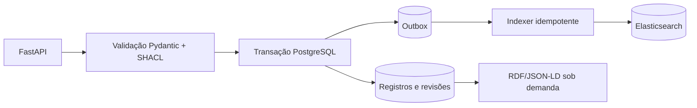

# ADR 0003 — Persistência transacional, RDF e índice de descoberta

- **Status:** Proposto — pendente de aprovação
- **Data:** 2026-10-22
- **Escopo:** Armazenamento, consistência, sincronização e recuperação

## Contexto

O Libris necessita preservar entidades bibliográficas, relações semânticas, revisões e dados operacionais de biblioteca. O backend atual não apresenta persistência implementada. A arquitetura de referência menciona PostgreSQL, Elasticsearch e eventual RDF Store; suas responsabilidades precisam ser definidas antes de criar tabelas ou sincronizações.

## Decisão proposta

1. **PostgreSQL como fonte de verdade inicial:** armazenar registros bibliográficos canônicos, identidades, relacionamentos, revisões e dados operacionais, com separação lógica por domínio. Escolher explicitamente a representação persistida (colunas normalizadas, JSONB, RDF serializado ou combinação) na implementação, documentando como reconstruir integralmente o grafo sem perda de propriedades.
2. **Elasticsearch como projeção derivada:** usar para pesquisa, ordenação e facetas, nunca como único local de armazenamento dos registros. Índices devem ser reconstruíveis a partir do PostgreSQL.
3. **RDF:** gerar e validar representações RDF/JSON-LD com RDFLib e SHACL. Não exigir um RDF Store dedicado no MVP. Reavaliar um triplestore quando consultas SPARQL, travessias complexas ou escala justificarem a operação adicional.
4. **Consistência:** gravação transacional no PostgreSQL, incluindo mudança do registro, revisão e um evento de outbox na mesma transação. Um processo idempotente projeta mudanças no Elasticsearch de forma assíncrona. Portanto, busca é **eventualmente consistente**; a leitura autoritativa usa PostgreSQL.
5. **Revisões e concorrência:** revisões monotônicas por recurso e atualização condicional (ETag/If-Match conforme contrato HTTP aprovado). Conflitos não podem sobrescrever silenciosamente alterações concorrentes.
6. **Falhas e recuperação:** retries com backoff e monitoramento de falhas de indexação; reprocessamento de outbox e comando de reindexação completa. Nunca tratar falha de indexação como perda do registro já confirmado no PostgreSQL.
7. **Evolução do esquema:** migrations versionadas (Alembic é a ferramenta recomendada), testes de migração, backup e restauração verificados antes de operação em produção.

## Fluxo proposto

O fluxo é uma proposta, **não** uma integração atualmente existente.

## Alternativas consideradas

- **Elasticsearch como fonte de verdade:** rejeitado por inadequação às garantias transacionais exigidas.
- **Escrita simultânea direta em PostgreSQL e Elasticsearch:** rejeitada pelo risco de divergência após falha parcial.
- **RDF Store obrigatório desde o início:** adiado devido a custo operacional e ausência de caso de uso comprovado no MVP.
- **PostgreSQL autoritativo + outbox + projeções:** recomendado.

## Consequências

A arquitetura ganha transações confiáveis e reindexação determinística, mas requer worker, outbox, métricas de atraso e tratamento explícito da consistência eventual. Consultas SPARQL sobre todo o catálogo não estarão disponíveis até a introdução de um serviço apropriado.

## Critérios de adoção

- CRUD de Work com persistência e leitura após reinício da aplicação.
- Migrações reproduzíveis em banco vazio.
- Atualização concorrente detectada sem perda de dados.
- Teste de falha de Elasticsearch: registro permanece íntegro e pode ser reindexado.
- Reprocessamento duplicado de eventos não duplica documentos nem regride revisões.
- Exportação RDF/JSON-LD validada e reconstruível a partir do armazenamento canônico.
- Procedimento documentado de backup/restauração e reindexação.

## Questões pendentes

Modelo físico do PostgreSQL, política de retenção de eventos, formato de projeções, índices e análise de desempenho, requisitos multi-instituição, infraestrutura do worker e necessidade futura de RDF Store.

## Relações

ADR 0001 (limites modulares), ADR 0002 (semântica e identidades), `docs/architecture/overview.md` e `docs/api/openapi.yaml`.
