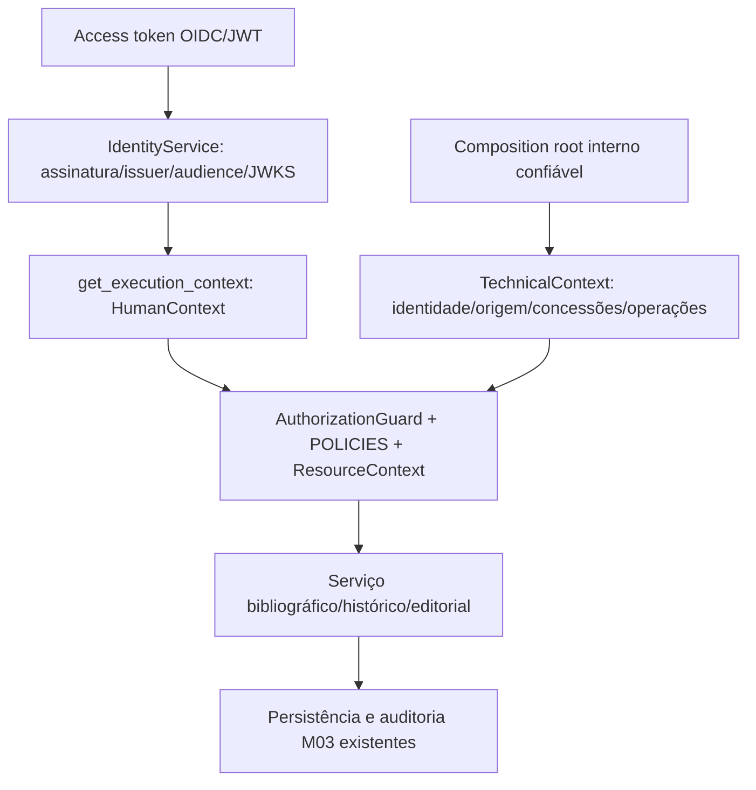

# Autorização por operação — M04.05 / #38

Contrato interno vigente. [ADR 0031](../decisions/0031-operation-authorization.md),
[evidências da execução](identity-m04-05-verification.md). Não publica APIs CRUD M05.

## Fluxo e confiança



Autenticação valida credencial; autorização verifica capacidades na operação atual.
`get_current_actor`, `require_permissions`, `/identity/me` e `/health` mantêm seus
contratos. Sem Bearer, token inválido, OIDC desabilitado ou audience de outro client:
401 e `WWW-Authenticate: Bearer`. Identidade válida insuficiente: 403. O handler
existente traduz `PermissionDenied` para `authorization.denied`, preservando o
schema Problem Details 1.0; `EditorialPermissionDenied` mantém o código editorial e a compatibilidade com
CatalogError, retornando 403. CatalogError genérico legado mantém seu fallback 422.

`HumanContext` conserva o ator de `IdentityService`, incluindo permissões efetivas.
`get_execution_context` é o adaptador HTTP confiável. Construção/coerência de hash
não comprova autenticação criptográfica dentro do processo: composition root,
dependências e chamadores internos são parte da base de confiança. Código capaz de
fabricar classes Python ou substituir guards é privilegiado. Não instanciar contextos
com valores recebidos do cliente nem usá-los como DTOs; não existe emissor técnico HTTP.

`TechnicalContext(actor_id, permissions, operations, origin)` é configuração imutável
interna. Namespace service/automated controlado, origem não vazia, conjuntos tipados.
Exige simultaneamente concessões e operação na allowlist; não aceita SYSTEM_ADMIN
ou operações exclusivamente humanas. Mesmo permissões editoriais avulsas não liberam
aprovação/publicação. Não há roles humanas no contexto técnico. `ExecutionActor` M03
é apenas metadado de auditoria; isoladamente não autoriza. Quando fornecido junto do
contexto, deve corresponder à mesma identidade técnica.

Não foi implementado M2M OIDC. A configuração OIDC humana atual pressupõe clients
sem service accounts privilegiadas; um JWT machine-to-machine futuro exige classificação
confiável no servidor e política própria (#39), nunca promoção automática por roles,
`source/process`, prefixos arbitrários do subject ou payload. HumanContext(TechnicalContext)
é recusado. Não há novos segredos, tokens ou infraestrutura de credenciais.

## Matriz de operações

`Operation` e `POLICIES` em identity são a fonte única; `OPERATION_PERMISSIONS`
editorial é uma visão de compatibilidade derivada. Todos os requisitos de uma linha
são conjuntos; alternativas somente onde explicitadas abaixo.

| Operação | Tipo do recurso | Permissões conjuntas | Modalidade e condições |
| --- | --- | --- | --- |
| bibliographic.read_public | bibliographic | nenhuma | público; published e revisão selecionada = pública positiva |
| authority.read_public | authority | nenhuma | mesmo contrato de projeção publicada |
| bibliographic.read_editorial | bibliographic | bibliographic:read + metadata_revision:read | humano/técnico com allowlist |
| authority.read_editorial | authority | authority:read + metadata_revision:read | humano/técnico com allowlist |
| bibliographic.create | bibliographic | bibliographic:create | humano/técnico; validação antes da transação |
| bibliographic.update | bibliographic | bibliographic:update | humano/técnico; perfil persistido, CAS e ciclo editável M03 |
| bibliographic.delete | bibliographic | bibliographic:delete | humano; política somente, nenhum delete implementado |
| authority.manage | authority | authority:manage | humano/técnico; criação/revisão de snapshots de autoridade existentes |
| metadata_revision.read | metadata | metadata_revision:read | humano/técnico; histórico proprietário |
| metadata_revision.create | metadata | metadata_revision:create | humano/técnico; política reutilizável, sem operação extra artificial |
| metadata_revision.restore | metadata | metadata_revision:read + metadata_revision:create | humano; cópia validada/CAS, sem publicação |
| metadata_audit.read | metadata | metadata_audit:read | humano/técnico; eventos autorizados |
| metadata.editorial_history | metadata | metadata_revision:read + metadata_audit:read | humano/técnico; leitura coerente do estado/histórico |
| editorial.submit | bibliographic/authority | editorial:submit | humano; draft → in_review |
| editorial.approve | bibliographic/authority | editorial:approve | humano; in_review → approved |
| editorial.return | bibliographic/authority | editorial:return | humano; in_review/approved → draft, justificativa |
| editorial.publish | bibliographic/authority | editorial:publish | humano; approved → published; revisão aprovada, SHACL/referências |
| editorial.withdraw | bibliographic/authority | editorial:withdraw | humano; published → withdrawn, justificativa |
| editorial.republish | bibliographic/authority | editorial:republish | humano; withdrawn → published; revisão publicada anterior revalidada |
| editorial.archive | bibliographic/authority | editorial:archive | humano; withdrawn → archived, justificativa |
| system.admin | system | system:admin | humano; política reutilizável, sem API administrativa artificial |

A máquina de estados pertence ao domínio bibliográfico; o guard não recria as
transições, validações ou CAS. Pré-verificação por destino permite publish **ou**
republish até carregar estado; a operação exata deve passar depois. Conteúdo existente
pré-verifica update bibliográfico **ou** authority.manage, então verifica perfil
armazenado antes de initialize/advance/save. O grafo proposto não define autorização.
Essas alternativas não substituem os conjuntos obrigatórios de cada política.

`BibliographicService.read` exige capacidade editorial de pelo menos um tipo antes
de carregar o snapshot e confere novamente o perfil real. HistoryService preserva
metadata_revision:read independente de metadata_audit:read. Não inventar ownership
institucional: reader não pode ler rascunhos só por bibliographic:read. Governança
e isolamento institucional permanecem dependências futuras, com acesso restrito atual.

`read_public` consulta estado bloqueado e retorna None para legado ou ausência de
public_revision. O guard verifica visibilidade antes da leitura do snapshot selecionado.
Candidata não substitui publicação anterior; withdrawn/archived não expõem snapshots.
Não usar `read`/current_revision como projeção pública. As políticas públicas dos dois
tipos usam a mesma regra; autoridades já pertencem ao serviço de snapshots existente.

## Integração de aplicação

Os três serviços recebem `authorization=` opcional no construtor para injeção;
por omissão criam sua própria instância. Nenhum singleton ou acesso a tabelas alheias.
`context=` é propagado por chamada. `actor=` é adaptador de compatibilidade somente
para AuthenticatedActor já validado e confiável, com checagem de coerência; fornecer
ator e contexto juntos é erro. `actor=None` e contexto ausente nunca autorizam
operação protegida. Não existe modo legado, grant automático ou fallback técnico.

Exemplo para futuro adaptador M05, sem introduzir rota nesta entrega:

```python
from rdflib import Graph
from libris.modules.bibliographic.application.service import BibliographicService
from libris.modules.bibliographic.domain.models import Provenance, ResourceIdentity, Revision
from libris.modules.identity.application.authorization import HumanContext

# FastAPI injeta Depends(get_execution_context) no parâmetro context.
# identity, graph e provenance são preparados pelo adaptador catalográfico existente/futuro.
async def create_from_request(
    service: BibliographicService, identity: ResourceIdentity, graph: Graph,
    provenance: Provenance, context: HumanContext,
) -> Revision:
    return await service.create(identity, graph, provenance, context=context)
```

Configuração técnica explícita no composition root de uma importação:

```python
from libris.modules.identity.application.authorization import TechnicalContext
from libris.modules.identity.domain.authorization import Operation
from libris.modules.identity.domain.permissions import Permission

catalog_import = TechnicalContext(
    actor_id="service:catalog-import",
    permissions=frozenset({Permission.BIBLIOGRAPHIC_CREATE}),
    operations=frozenset({Operation.BIBLIOGRAPHIC_CREATE}),
    origin="composition-root:catalog-import",
)
# await service.create(identity, graph, provenance, context=catalog_import)
# revise/read/approve/publish não pertencem a este escopo.
```

Um futuro módulo chama `guard.require(context=..., operation=Operation.AUTHORITY_MANAGE,
resource=ResourceContext(ResourceKind.AUTHORITY))` antes de sua operação, sem consultar
identity tables ou presumir bibliographic:update. Recursos/estados são fornecidos
pelo módulo proprietário sob seus locks/transações, nunca confiados ao body do cliente.

Autorização negada não inicia transação quando a decisão independe do recurso. Quando
perfil/estado persistido é necessário, a consulta mínima ocorre antes das mutações;
falha reverte a transação. Persistência, eventos exatamente uma vez, expectativas de
revisão/versão, proveniência e snapshots permanecem os contratos M03.

## Legado, evidências e limites

Revision.actor_id e autoria histórica continuam nullable. Ler/restaurar legado exige
identidade atual legítima, sem atribuir autor fictício ao snapshot passado. Novas
operações técnicas registram identidade técnica explícita; NULL antigo não prova serviço.
Fixtures que representam legado inserem snapshots por stores em banco descartável,
sem criar um bypass no serviço de aplicação.

A matriz de seis papéis/17 permissões permanece em ROLE_PERMISSIONS. Admin enumera
as 17 concessões; crescimento do enum não amplia o papel automaticamente. Tests usam
matriz esperada independente, uniões, operações desconhecidas, conjunções, falta de
contexto, SYSTEM_ADMIN isolado, contexto técnico, spoof HTTP e spies sem acesso à sessão.
A regressão PostgreSQL usa bancos exclusivos, sem dados de trabalho.

Escopo futuro: CRUD HTTP M05, escopo institucional, governança/revogação/M2M #39,
auditoria de segurança #41 e homologação #42. As políticas preparadas não significam
endpoints disponíveis. Nenhuma mudança de frontend, lock, perfil, SHACL ou migração.
