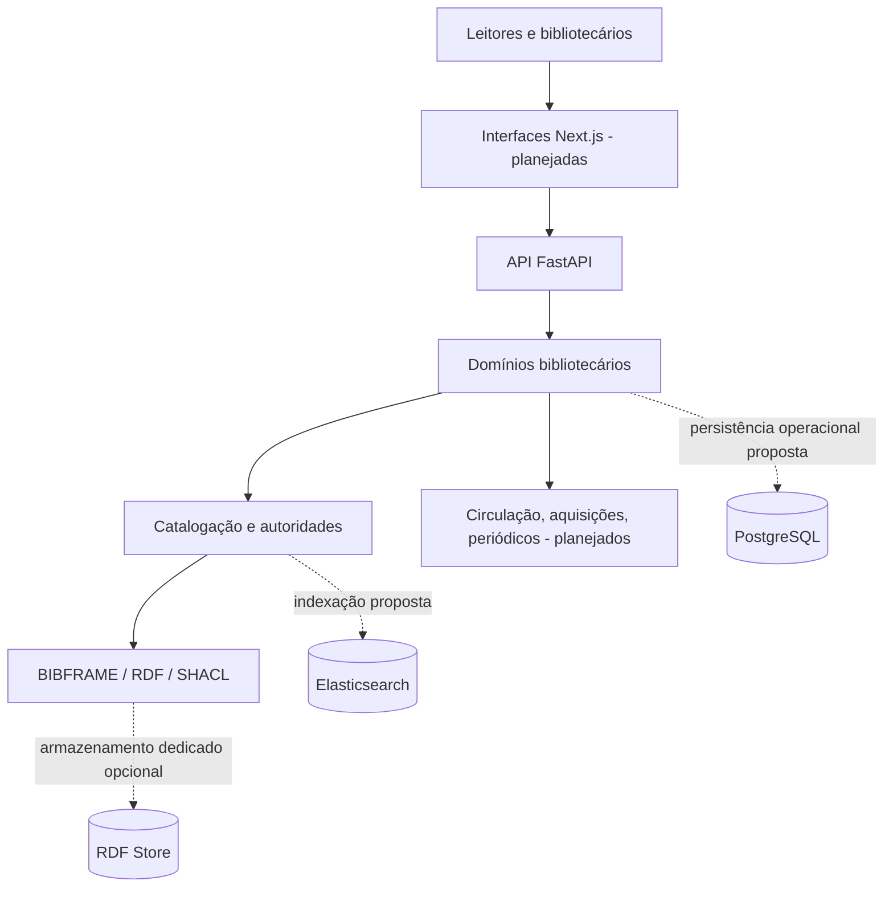

# Arquitetura do Libris

> **Status:** visão arquitetural inicial. Este documento distingue decisões pretendidas de componentes efetivamente presentes no repositório. Não substitui os registros de decisões arquiteturais (ADRs).

## 1. Propósito e contexto

O **Libris** é um Sistema Integrado de Gestão de Bibliotecas (ILS) de código aberto, modular e de nível corporativo. Pretende integrar operações bibliotecárias e descoberta de recursos com **Web Semântica** e **Linked Open Data**. O **BIBFRAME** é o modelo bibliográfico principal, com suporte extensível a outras ontologias e vocabulários.

O produto prevê catalogação, circulação, autoridades, aquisições, periódicos, gestão de usuários, relatórios e estatísticas, além de descoberta pública. Esses módulos são **escopo do produto**, não evidência de implementação atual.

## 2. Diretrizes tecnológicas

| Camada | Tecnologia de referência | Situação |
| --- | --- | --- |
| API e regras de negócio | Python 3.12+, FastAPI, Pydantic | Base inicial presente no backend |
| Interface pública e administrativa | Next.js, React | Planejada; não identificada na árvore `main` analisada em 22/10/2026 |
| Busca e facetas | Elasticsearch | Arquitetura-alvo; integração não verificada |
| Dados operacionais | PostgreSQL | Proposta de arquitetura; implantação não verificada |
| Dados semânticos | RDF, JSON-LD, BIBFRAME, SHACL | Modelos, serialização e shape inicial presentes |
| Repositório RDF dedicado | A definir | Recomendação em estudo, não decisão confirmada |

Não assumir serviços, bancos, filas ou infraestrutura como existentes sem verificar código, configuração e ADRs.

## 3. Visão lógica



As setas pontilhadas representam integrações **propostas**, não implementações verificadas.

## 4. Limites de domínio

- **Bibliográfico:** entidades, títulos, relações Work–Instance–Item, metadados e perfis de catalogação.
- **Autoridades:** pessoas, organizações, assuntos, identificadores e reconciliação com fontes externas.
- **Circulação:** exemplares, empréstimos, devoluções, reservas e políticas operacionais.
- **Aquisições e periódicos:** processos de aquisição, assinaturas e controle de fascículos.
- **Descoberta:** indexação, busca, facetas e navegação por entidades.
- **Administração:** usuários, permissões, configuração, auditoria e relatórios.

**Regra de separação:** entidades e relações bibliográficas não devem depender diretamente de regras de empréstimos, multas ou reservas. Interfaces e APIs devem respeitar contratos de domínio explícitos.

## 5. Modelo bibliográfico e interoperabilidade

O modelo principal é **BIBFRAME**:

- `bf:Work`: identidade intelectual da obra.
- `bf:Instance`: materialização/publicação relacionada à obra (`bf:instanceOf` / `bf:hasInstance`).
- `bf:Item`: exemplar individual associado à instância (`bf:itemOf` / `bf:hasItem`).

O projeto prevê interoperabilidade com **MARC 21**, **RDA**, **SKOS**, **Schema.org**, **VIAF** e **Wikidata**, sem presumir conectores já disponíveis. Perfis semânticos e validação SHACL devem governar restrições de propriedades e cardinalidade. Conversões não devem descartar propriedades RDF silenciosamente.

### Implementação inicial observada

Na árvore `main` consultada em 22/10/2026 constam:

- `backend/app/catalog/shared/title/models.py`: modelos Pydantic de títulos de Work e Instance.
- `backend/app/catalog/shared/title/rdf.py`: conversão entre modelos e grafos RDF/JSON-LD, com rejeição de predicados não suportados em importação.
- `backend/app/catalog/shared/title/shapes/title-v1.ttl`: shape inicial.
- `backend/tests/contracts/title/`: testes e exemplos de contratos.

Esses componentes não equivalem a um módulo completo de catalogação.

## 6. API e contratos

O arquivo `docs/api/openapi.yaml` descreve um **contrato inicial proposto** para recursos bibliográficos e perfis de catalogação. Sua presença não garante que todos os endpoints estejam implementados.

Princípios recomendados:

1. Separar validação de entrada, lógica de domínio, serialização e transporte HTTP.
2. Tratar identificadores persistentes como parte do contrato.
3. Definir representação JSON e JSON-LD explicitamente.
4. Versionar mudanças incompatíveis em contratos e perfis.
5. Garantir erros previsíveis e testes de regressão para comportamento publicado.

Antes de implementar endpoints, comparar OpenAPI, modelos existentes, testes e decisões aprovadas. Inconsistências devem ser registradas, não resolvidas por suposição.

## 7. Persistência e indexação

A arquitetura de referência distingue três responsabilidades:

- **PostgreSQL:** transações e dados operacionais.
- **Elasticsearch:** índice de descoberta, busca e facetas, derivado de dados autoritativos.
- **RDF Store (opcional):** persistência/consulta de grafos semânticos, se uma ADR aprovar essa escolha.

A estratégia de fonte de verdade, sincronização, consistência, reindexação, IDs e eventos **ainda precisa de decisão formal**. Não implementar escrita simultânea em múltiplos armazenamentos sem política definida de recuperação e consistência.

## 8. Organização atual do código

```text
backend/
  app/
    api/
      health_router.py
    catalog/shared/title/
      models.py
      rdf.py
      shapes/title-v1.ttl
    main.py
  tests/
    api/
    contracts/title/
  pyproject.toml
docs/
  api/openapi.yaml
  architecture/
    overview.md
    principles.md
    decisions/
  domain/
```

A organização acima reflete a árvore analisada; a estrutura pode evoluir conforme ADRs aprovadas. Os arquivos de decisões `0001-modular-monolith.md`, `0002-bibliographic-model.md` e `0003-persistence-strategy.md` estavam vazios nessa revisão; seus nomes **não comprovam decisões aprovadas**.

## 9. Qualidade, segurança e operação

- Validar entradas com modelos tipados e, quando aplicável, SHACL.
- Cobrir contratos, conversões RDF/JSON-LD e casos de erro com testes automatizados.
- Não registrar segredos ou dados pessoais desnecessários em logs.
- Planejar autenticação, autorização, trilhas de auditoria e isolamento de permissões antes de liberar módulos administrativos.
- Definir observabilidade, backups, migrações e implantação em documentos operacionais futuros.
- Não alegar conformidade, disponibilidade ou desempenho sem evidência de testes.

O `backend/README.md` existente descreve a inicialização local via `fastapi dev app/main.py` e testes de API com `python -m pytest tests/api`. Validar o ambiente e os caminhos antes de automatizar comandos adicionais.

## 10. Decisões pendentes

Os pontos seguintes devem ser discutidos e documentados em ADRs:

1. Monólito modular ou outra estratégia de implantação.
2. Contrato canônico do modelo bibliográfico e evolução de perfis.
3. Fonte de verdade para RDF e dados operacionais.
4. Necessidade e seleção de RDF Store.
5. Estratégia de sincronização e reindexação do Elasticsearch.
6. Autenticação, autorização, multi-instituição e limites de tenancy.
7. Versionamento da API, migrações e compatibilidade.

## 11. Orientações para agentes de IA

Antes de modificar o projeto:

1. Ler `AGENTS.md`, quando existir, e as instruções locais aplicáveis.
2. Consultar este documento, os ADRs preenchidos e `docs/domain/`.
3. Verificar o código e os testes reais; não confundir roadmap com funcionalidade implementada.
4. Preservar contratos existentes, especialmente BIBFRAME, JSON-LD e SHACL.
5. Propor ADR para mudanças estruturais; não decidir arquitetura por conta própria.
6. Executar testes pertinentes e informar claramente os resultados e limitações.
7. Atualizar a documentação afetada na mesma alteração.

## 12. Referências do projeto

- **Objetivo do Projeto Libris** — visão e requisitos de alto nível fornecidos ao projeto.
- **Referências de softwares e catálogos para o projeto Libris** — FOLIO (modularidade), Koha (processos), MARVA e Sinopia (catalogação), Share-VDE (entidades), VuFind e Primo NDE (descoberta e UX).
- `docs/api/openapi.yaml` — proposta de contrato de API.
- `backend/app/catalog/shared/title/` — implementação semântica inicial.

**Manutenção:** atualizar este documento quando decisões arquiteturais forem aprovadas ou quando componentes planejados passarem a existir no código.
