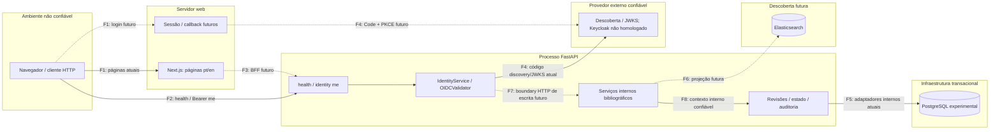

# Modelo de ameaças — M04.01 / #34

Avaliação em 2026-10-13, checkout e estados IT/IO/EP/ND na
[baseline](security-baseline.md). Este é um modelo arquitetural qualitativo,
não um pentest nem homologação Keycloak/produção. Controles atuais são associados
a código/testes; recomendações futuras não são controles implantados.

## Método, ativos e classificação

STRIDE: S = Spoofing (identidade falsa), T = Tampering (adulteração),
R = Repudiation (repúdio), I = Information Disclosure (divulgação),
D = Denial of Service (indisponibilidade), E = Elevation of Privilege (elevação).
A classificação segue a [referência Microsoft sobre STRIDE](https://learn.microsoft.com/en-us/archive/msdn-magazine/2006/november/uncover-security-design-flaws-using-the-stride-approach).
Para o login futuro, recomendações de PKCE, CSRF e redirect seguem
[RFC 9700, seções 2.1 e 4](https://www.rfc-editor.org/rfc/rfc9700.html), além da #36.

Ativos: identidade/permissões confiáveis; tokens/sessões; revisão pública selecionada;
rascunhos/histórico restrito; UUID/URI e snapshots imutáveis; auditoria/proveniência;
disponibilidade de API/provedor/banco; dados pessoais futuros e configuração.
Adversários incluem cliente anônimo, usuário com privilégio insuficiente, operador
malicioso, atacante de rede e código/infraestrutura comprometidos. O emissor,
configuração e chamador interno são raízes de confiança, não inputs do usuário.

Probabilidade antes dos controles: baixa (exige acesso privilegiado ou condições
incomuns), média (falha plausível de configuração/integrador), alta (entrada acessível
a cliente comum e tentativa simples). Impacto: baixo (efeito local reversível),
médio (exposição limitada ou indisponibilidade temporária), alto (autoria/privilégio
indevido, exposição restrita ou corrupção relevante). Severidade inerente é calculada
pela tabela abaixo; estado/controles indicam redução e risco residual separadamente.
Fluxos futuros têm avaliação prospectiva, não probabilidade de exploração atual.

| Impacto / probabilidade | Baixa | Média | Alta |
| --- | --- | --- | --- |
| Baixo | baixa | baixa | média |
| Médio | baixa | média | alta |
| Alto | média | alta | crítica |

“Mitigada” cobre o cenário delimitado dentro das premissas de confiança, sem afirmar
risco zero. “Parcialmente mitigada” tem controle concreto e lacuna; “pendente” não
tem mitigação suficiente; “não aplicável no estado atual” significa fluxo ausente,
com exigência registrada para antes de ativá-lo.

## Fronteiras de confiança

Linhas contínuas indicam código/capacidade atual, não homologação operacional;
tracejadas indicam integração futura. F4 é implementada/testada com MockTransport,
F5 é serviço interno com adaptador PostgreSQL, sem API catalográfica operacional.

| Fronteira | Estado real / confiança atravessada |
| --- | --- |
| F1 navegador ↔ Next.js | Páginas públicas atuais; sessão/login/callback futuro #36/#37. Browser não fornece contexto autenticado confiável |
| F2 navegador ↔ FastAPI | /health público, /me Bearer protegido, documentação automática pública; mutações de domínio futuras M05 |
| F3 Next.js ↔ FastAPI | Futuro; API_INTERNAL_URL reservado. Página não consulta API; futuro servidor encaminha access token, não papéis inventados |
| F4 FastAPI ↔ OIDC | Discovery/JWKS implementados, assinatura local/mock testados; Keycloak real #35 pendente. Login navegador/web ↔ provedor também futuro #36 |
| F5 FastAPI ↔ PostgreSQL | Engine e serviços internos de persistência atuais; sem consulta de domínio no startup/health, sem endpoint CRUD. Banco/configuração/DBA são confiança distinta |
| F6 FastAPI ↔ Elasticsearch | Futuro: container local não equivale a projeção ou política de visibilidade operacional |
| F7 serviços internos ↔ módulos | Contratos atuais identity/bibliographic; guard geral #38 e outros domínios futuros; nenhum acesso direto a tabelas de outro módulo |
| F8 contexto autenticado ↔ revisões/auditoria | Ator propagado por objeto interno atual; ligação HTTP de escrita futura. Hash coerente não comprova autenticação de objeto fabricado |

## Registro de cenários

As duas tabelas abaixo constituem um único registro ligado por ID estável:
cada ameaça tem cenário/pré-condições/impacto/classificação e
controle/lacuna/mitigação/estado/responsável/evidência. IDs não devem ser reutilizados.

| ID | Componente / fronteira / STRIDE | Ativo e cenário de ataque | Pré-condições | Impacto | Probabilidade | Severidade |
| --- | --- | --- | --- | --- | --- | --- |
| TH01 | JWT, F2/F4, S/T/E | Identidade: assinatura falsa ou claims de admin adulteradas | Enviar token à API | alto | alta | crítica |
| TH02 | JWT, F2/F4, S/E | Identidade: none, HS256 ou algoritmo fora da allowlist | Cliente controla header JOSE | alto | alta | crítica |
| TH03 | JWT, F2/F4, S/E | Identidade: expirada, aud incorreta, iss/sub inválidos, nbf/iat futuros | Token inválido/reutilizado disponível | alto | alta | crítica |
| TH04 | JWT, F2/F4, S/E | API aceita ID token em lugar de access token | Token de login válido para outro uso ou configuração de discriminador inadequada | alto | média | alta |
| TH05 | Chaves, F2/F4, S/T/I | JWT aponta jku/x5u de atacante para trocar chave ou atingir rede interna | Header arbitrário | alto | alta | crítica |
| TH06 | Discovery/configuração, F4, S/T/E | Trocar issuer ou jwks_uri confiável, incluindo egress indevido | Alteração do ambiente/provedor ou descoberta incompatível | alto | média | alta |
| TH07 | Discovery/JWKS, F4, D/S | Documento inválido/grande, chave ambígua ou provedor indisponível bloqueia autenticação | Resposta defeituosa/hostil ou interrupção | médio | alta | alta |
| TH08 | Cache, F2/F4, D | kid aleatório induz consultas e consome disponibilidade OIDC | Requisições repetidas por cliente | médio | alta | alta |
| TH09 | RBAC, F2/F7, E | Papel desconhecido, de outro client ou payload/header amplia permissões | Entrada controlada ou integrador usa origem errada | alto | alta | crítica |
| TH10 | Administração, F7/F4, E/R | Concessão admin excessiva ou system:admin usado como bypass | Conta/operador privilegiado ou novo consumidor incorreto | alto | média | alta |
| TH11 | Conteúdo/histórico, F2/F3/F7, I/E | Expor draft/candidata/revisões por read de baixo nível ou exportação | Futura rota conecta primitiva sem guard/seleção pública | alto | média | alta |
| TH12 | Ator, F7/F8, S/R/E | Injetar actor_id de terceiro ou objeto com permissões inventadas | Chamador aceita payload como contexto ou código interno comprometido | alto | média | alta |
| TH13 | Token/sessão/log, F1/F2/F3/F8, I | Tokens/PII em logs, URL pública, localStorage, HTML ou NEXT_PUBLIC | Instrumentação indevida ou integração web futura | alto | média | alta |
| TH14 | Web, F1, T/I/E | XSS executa ações/exfiltra sessão ou conteúdo administrativo | Conteúdo não confiável renderizado no futuro editor/shell | alto | média | alta |
| TH15 | Sessão/callback, F1/F3/F4, S/T/E | CSRF/login CSRF, state adulterado, fixação de sessão | Login/sessão com cookies futuros ativados | alto | média | alta |
| TH16 | OIDC web, F1/F4, I/S | Redirect aberto/callback permissivo desvia código e sessão | Futuro fluxo aceita destino arbitrário | alto | média | alta |
| TH17 | Atores internos/técnicos, F7/F8, E/R | Serviço/automação assume humano ou acessa outra unidade/usuário | Contexto técnico sem política de privilégio/escopo | alto | média | alta |
| TH18 | Editorial, F7/F8/F5, T/E | bibliographic:update publica, aprovação obsoleta ou validação incompleta autoriza transição | Chamador tenta aresta indevida, revisão concorrente ou dependência ausente | alto | média | alta |
| TH19 | Auditoria/PG, F5/F8, T/R | Estado sem evento, snapshot sobrescrito ou autoria retroativa falsa | Escrita parcial, SQL privilegiado, falha de auditoria | alto | média | alta |
| TH20 | Descoberta, F6, I/E | Índice/exportação revela rascunhos ou dados pessoais | Primeira indexação futura sem política de projeção | alto | média | alta |
| TH21 | Operação, F1/F2/F4/F5/F6, I/E | Usar defaults/HTTP/start-dev/ES aberto de dev em produção | Implantação copia Compose sem revisão | alto | média | alta |
| TH22 | API/PG/OIDC, F2/F4/F5, D | Flood JWT, requisições e validações/canonicalização/locks esgotam CPU/pool | Cliente acessa endpoints; ingestão pesada futura | médio | alta | alta |
| TH23 | Tokens/provedor, F2/F4, S/E | Conta/papel revogado continua usando JWT já emitido | Token ainda não expirado; revogação no provedor | alto | média | alta |
| TH24 | Dependências/ator, F4/F7/F8/F5, E/T | Falha de identidade/autorização gera fallback anônimo ou gravação | Integrador captura erro e substitui ator/política | alto | média | alta |

## Controles, lacunas e tratamento

Evidências abreviadas: `I` = [módulo identity](../../apps/api/src/libris/modules/identity/);
`B` = [módulo bibliographic](../../apps/api/src/libris/modules/bibliographic/);
`TI` = [test_identity.py](../../tests/api/identity/test_identity.py);
`TE` = [test_editorial.py](../../tests/api/test_editorial.py);
`TA` = [test_audit_history.py](../../tests/api/test_audit_history.py);
`TP` = [test_editorial_postgres.py](../../tests/integration/test_editorial_postgres.py).
Testes citados são controles delimitados, não alegação de E2E; resultados atuais
na [verificação](security-m04-01-verification.md).

| ID | Controle comprovado / evidência técnica | Lacuna / mitigação recomendada | Estado | Responsável futuro |
| --- | --- | --- | --- | --- |
| TH01 | `I/infrastructure/oidc.py::validate` verifica assinatura; TI::test_signature_and_manipulated_roles | Proteger raiz OIDC/chaves/configuração; validar emissão real | mitigada para falsificação sem chave confiável | #35/#42 |
| TH02 | `Settings.validate_oidc`, allowlist e chaves assimétricas; TI::test_disallowed_algorithm/test_settings_fail_closed | RSA testado; acrescentar cobertura para algoritmos efetivamente adotados, sem ampliar allowlist por conveniência | mitigada para none/HS256/fora da lista | #42 |
| TH03 | PyJWT + exigências explícitas; TI::test_invalid_claims/test_expiration_infinity | Tolerância 30 s configurável não é expiração exata; verificar relógios/emissão real | mitigada dentro da configuração vigente | #35/#42 |
| TH04 | Discriminador assinado no payload; TI::test_invalid_claims | Audience/discriminador específicos dependem do provedor; testar ID/access reais | parcialmente mitigada | #35/#42 |
| TH05 | Somente descoberta escolhe JWKS; TI::test_cache_expiration_rotation_and_refresh_limit confirma jku ignorado | x5u não usado por inspeção, sem teste dedicado; adicionar caso negativo | mitigada para URLs de token | #42 |
| TH06 | Issuer exato, descoberta confere issuer; HTTPS produção; TI::test_provider_failure_and_backoff/test_settings_fail_closed | Configuração/provedor comprometidos continuam confiáveis; jwks_uri não tem restrição adicional de host/rede; controlar mudanças/egress | parcialmente mitigada | #35/#40 e implantação aprovada |
| TH07 | Timeout, limites 1 MiB/100 chaves, unicidade; TI::test_provider_failure_and_backoff/test_incompatible_keys | Limites grandes/key_ops/redirect sem casos dedicados; sem disponibilidade garantida; testar e monitorar, preservar fail closed | parcialmente mitigada | #35/#40/#42 |
| TH08 | Intervalo inclusive falha + lock; TI::test_cache_expiration_rotation_and_refresh_limit/test_concurrent_initial_requests_share_refresh | Limite por worker não é rate limit global; rotação pode gerar 401 temporário; quotas no HTTP | parcialmente mitigada | #40/#42 |
| TH09 | `I/infrastructure/role_mapper.py`; TI::test_role_mapping/test_union_and_trusted_role_source | Primitivas create/revise/read confiam no chamador; boundary por operação/recurso ainda pendente; nunca ler roles do cliente | parcialmente mitigada | #38/M05 |
| TH10 | authorize exige conjunto específico; admin recebe enum completo; mapa e TI::test_role_mapping | Admin amplo e cresce com enum; sem quatro olhos nem gestão auditável; menor privilégio/provisionamento/revogação | parcialmente mitigada | #38/#39/#41 |
| TH11 | read_public seleciona publicada; HistoryService autoriza; TA::test_history_denial_precedes_storage; TP::test_persistent_workflow_candidate_return_restore_and_archive | Sem rotas públicas ou política contextual completa; expor projeção selecionada e guards; validar composição/exportação | parcialmente mitigada nos serviços internos; HTTP futuro | #38/M05; demais APIs M05–M15 conforme escopo |
| TH12 | audit_actor rejeita dict/hash divergente; TA::test_trusted_human_unknown_and_privacy/test_service_rejects_payload_actor_before_storage | Hash recomputável não autentica objeto fabricado; obter contexto do OIDC no boundary e evitar deserialização | parcialmente mitigada | #38/#41/M05 |
| TH13 | Logs OIDC genéricos por inspeção; envelope não guarda token/iss/sub; TA::test_trusted_human_unknown_and_privacy | Sem testes de todos os logs/proxies; textos livres podem conter PII; sessão web ausente; redigir logs e testes de ausência de credenciais | parcialmente mitigada | #36/#40/#41/#42 |
| TH14 | Página atual usa texto do dicionário, sem editor; [App Router](../../apps/web/src/app/) | CSP/sanitização e testes de conteúdo não confiável antes de editor/shell | não aplicável no estado atual ao conteúdo administrativo | #37/#40; editor futuro conforme escopo |
| TH15 | Realm exige PKCE S256, mas não há callback/sessão | Implementar state, PKCE, nonce quando pertinente, cookies HttpOnly/Secure/SameSite, defesa CSRF e rotação/expiração de sessão; testar adulteração | não aplicável no estado atual | #36/#40/#42 |
| TH16 | Realm registra URI exata; sem fluxo Next.js | Validar destino de retorno e callback; impedir redirect arbitrário; teste real | não aplicável no estado atual | #35/#36/#40/#42 |
| TH17 | ExecutionActor enum/namespace, contexto humano/técnico exclusivo; TA::test_execution_context/test_technical_namespace_is_controlled; auditoria editorial exige humano | ExecutionActor não é credencial nem guard; sem isolamento institucional/contas de serviço operacional; definir privilégio restrito | parcialmente mitigada | #38/#39; escopo multiunidade futuro conforme documentação |
| TH18 | OPERATION_PERMISSIONS, matriz fechada, SHACL/referências, CAS/gate; TE::test_permissions_reject_without_mutation/test_publication_dependencies_fail_closed/test_shacl_unavailable_never_produces_publication; TP::test_local_dependency_cannot_change_between_validation_and_commit | Cobertura física atual separada; serviços devem aderir ao gate; não estender garantia a fontes externas | parcialmente mitigada, política de domínio comprovada | #38/#42/M05 |
| TH19 | `B/application/service.py`, AuditStore, migrações 0001/0003/0004: transação única e triggers; [test_audit_postgres.py](../../tests/integration/test_audit_postgres.py)::test_audit_failure_rolls_back_resource_revision_and_cas/test_postgres_blocks_audit_mutation | DBA pode desativar triggers/editar URI; sem prova criptográfica ou retenção institucional; separar privilégios/backup e eventos segurança | parcialmente mitigada | #41/#42 e operação futura aprovada |
| TH20 | Nenhuma projeção implantada; [overview](overview.md), ADR 0015 | Antes de indexar: campos mínimos, somente publicada, retirada/republicação, consistência/outbox e reconstrução com autorização | não aplicável no estado atual | descoberta M05–M15 conforme escopo; novo ADR de consistência antes da integração |
| TH21 | Loopback, validação config e credenciais por ambiente; [Compose](../../docker-compose.yml), overlay | ES sem auth/start-dev/HTTP não servem produção; defaults continuam possíveis; TLS/rede/credenciais/ambiente dedicados | pendente para produção | #35/#40 e implantação conforme escopo |
| TH22 | JWT 16 KiB, timeout/cache; parser RDF limitado e paginação 200; TI::test_malformed; TA::test_query_limit | Sem rate limit global/benchmarks/timeout de lock comprovados; limitar concorrência/tamanho, medir cargas e gate | parcialmente mitigada | #40/#42; ingestão/descoberta posteriores |
| TH23 | exp verificado e TTL de chaves; TI::test_invalid_claims | API não consulta revogação/introspecção por requisição; revogar papel não invalida JWT emitido; procedimento/prazos de sessão/token | parcialmente mitigada | #39/#36/#42 |
| TH24 | Dependência 401, autorização 403; TE::test_publication_dependencies_fail_closed/test_shacl_unavailable_never_produces_publication | Falhas inesperadas/ator None em todas as operações não testadas; create/revise aceitam ausência interna por contrato; guard futuro deve exigir ator onde necessário, sem fallback | parcialmente mitigada | #38/#40/#42/M05 |

## Fail closed: comportamento efetivo e requisito futuro

| Cenário | Comportamento atual / prova | Requisito ou limite |
| --- | --- | --- |
| OIDC_ENABLED=false | /me 401 mesmo com Bearer; /health 200; TI::test_disabled_never_bypasses_authentication | Desabilitar OIDC nunca torna uma operação protegida anônima |
| Bearer ausente/esquema errado | 401 + WWW-Authenticate: Bearer; TI::test_fastapi_authentication_authorization_and_override | /health e docs públicos têm política distinta |
| JWT inválido/malformado/expirado | AuthenticationError; dependência converte em 401; TI::test_malformed/test_invalid_claims e teste HTTP de Bearer invalid | Não alegar que cada caso negativo JWT já foi testado também via HTTP |
| JWKS indisponível | Sem cache válido falha; TI::test_provider_failure_and_backoff/test_no_stale_keys_after_expiration | Chave conhecida ainda válida no cache permite autenticação sem consulta; isso não é fallback anônimo ou uso de chave expirada |
| Chave desconhecida | Refresh limitado; sem chave compatível AuthenticationError/401; TI::test_unknown_key_after_refresh/test_cache_expiration_rotation_and_refresh_limit | Pode haver 401 temporário para chave legítima durante intervalo |
| Assinatura inválida | AuthenticationError/401; TI::test_signature_and_manipulated_roles | Não confiar em claims antes de validar |
| Permissão insuficiente | require_permissions 403; TI::test_fastapi_authentication_authorization_and_override | Editorial usa erro de domínio; HTTP futuro deve mapear corretamente sem inventar endpoint |
| Papel desconhecido | map_permissions retorna vazio; TI::test_role_mapping | /me pode retornar 200 para identidade válida; operações privilegiadas recusam; caso HTTP específico unknown-role ainda não identificado |
| Dependência necessária à decisão indisponível | Publicação recusa contexto/perfil/SHACL/referência ausentes; TE::test_publication_dependencies_fail_closed/test_shacl_unavailable_never_produces_publication | Falha de banco impede commit; provas físicas no TP, execução separada; indisponibilidade de serviço identity/app.state não possui teste dedicado e não se promete 401 para toda exceção |
| Identidade ausente onde obrigatória | HTTP atual exige get_current_actor; editorial/histórico/restauração exigem actor tipado e validam contexto/permissão | Não há matriz completa de actor=None nessas chamadas; fortalecer em #38/#42. create/revise internos permitem None por compatibilidade e não podem ser expostos como escrita anônima |

Nenhum mecanismo futuro pode capturar falha de autenticação/autorização e substituí-la
por actor None, admin fictício ou operação sem guard. A disponibilidade do /health
continua independente do provedor e dos bancos: liveness não comprova readiness.

## Riscos residuais e revisão

Prioridades antes de APIs M05: #35 comprovar emissão real e rotação; #38 fechar o
boundary de aplicação/recursos; #36/#37 implementar sessão e UI com contexto do
servidor; #40 limitar abuso e revisar HTTP; #39 controlar concessões/serviços;
#41 definir eventos de segurança sem duplicar snapshots; #42 validar integração E2E.
Riscos de HTTP futuro não são mitigados por funções internas isoladas.

Continuam fora da garantia: provedor/host/DBA comprometidos, JWT roubado ainda válido,
claims confiáveis concedidas indevidamente, PII em texto livre, disponibilidade sob
carga, escopo institucional ainda indefinido e consistência de referências externas.
O modelo deve ser revisto ao ativar cada fronteira futura, alterar concessões,
introduzir login ou iniciar indexação. Aceitar #34 documentalmente não aceita esses
riscos em produção nem encerra M04; condições no [checklist](security-m04-exit-criteria.md).
