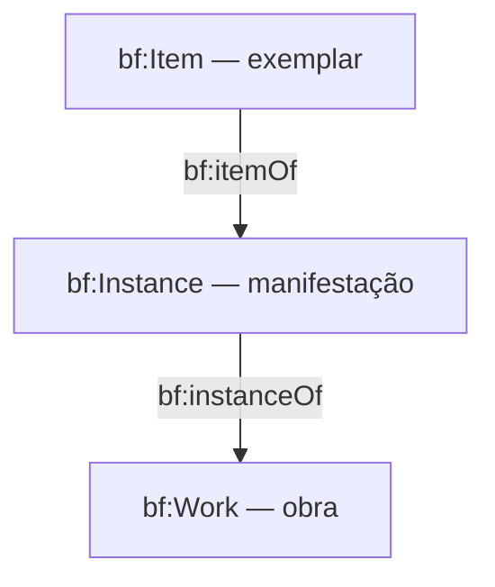

# Domínio bibliográfico — Libris

> **Status:** documentação de domínio e diretrizes de evolução. Não implica que todas as entidades, rotas ou integrações descritas estejam implementadas.

## 1. Objetivo e escopo

O Libris é um Sistema Integrado de Gestão de Bibliotecas (ILS) de código aberto, modular e orientado a dados conectados. O **BIBFRAME** é seu modelo bibliográfico principal, com abertura a outras ontologias e vocabulários. Este documento orienta desenvolvedores e agentes de IA sobre entidades, relacionamentos, validação e contratos do domínio bibliográfico.

O escopo abrange descrição de recursos, títulos, identificadores, agentes, assuntos, relacionamentos entre recursos e intercâmbio semântico. Regras de empréstimo, reserva, multas, aquisições e exemplares operacionais devem permanecer separadas do núcleo de descrição bibliográfica, ainda que possam referenciar seus identificadores.

## 2. Fontes de verdade e estado atual

Na branch `main` inspecionada em 22/10/2026, existem:

- `backend/app/catalog/shared/title/models.py`: modelos Pydantic de títulos de Work e Instance.
- `backend/app/catalog/shared/title/rdf.py`: transformação RDF/JSON-LD e importação restritiva.
- `backend/app/catalog/shared/title/shapes/title-v1.ttl`: shape SHACL do contrato de títulos.
- `backend/tests/contracts/title/`: testes e exemplos de contrato.
- `docs/api/openapi.yaml`: **proposta inicial** de API bibliográfica, não evidência de que os endpoints estejam implementados.

O projeto prevê FastAPI, Next.js e Elasticsearch. Persistência relacional e armazenamento RDF aparecem nas referências arquiteturais como possibilidades de evolução; decisões definitivas devem ser registradas em ADRs. **Não assumir que há uma implementação completa de Work, Instance, Item, autoridades, catálogo ou indexação.**

Ordem de consulta para alterações: código e testes existentes → SHACL e contratos aplicáveis → ADRs aprovados → esta documentação → visão do produto. Quando houver divergência, documentar e pedir decisão, em vez de alterar contratos silenciosamente.

## 3. Entidades BIBFRAME

### 3.1 Work (`bf:Work`)

Representa a concepção intelectual ou artística de um recurso. Pode carregar títulos, idiomas, assuntos, contribuições e relações com outras obras. Uma obra não equivale a uma edição física nem a um exemplar.

### 3.2 Instance (`bf:Instance`)

Representa uma materialização específica de uma Work, por exemplo uma edição impressa ou publicação digital. A ligação é `bf:instanceOf` (Instance → Work), com inversa `bf:hasInstance` (Work → Instance). Propriedades editoriais, suporte, identificadores de edição e publicação devem ser modelados no nível adequado.

### 3.3 Item (`bf:Item`)

Representa um exemplar individual associado a uma Instance por `bf:itemOf` (Item → Instance), com inversa `bf:hasItem`. Identificação de exemplar e localização podem se relacionar com dados operacionais de acervo; **políticas de circulação não pertencem ao modelo bibliográfico central**. A implementação de Item ainda deve ser verificada no código antes de qualquer extensão.



### 3.4 Agentes, assuntos e autoridades

Pessoas, organizações e conceitos devem ser tratados como entidades reutilizáveis quando apropriado, preferencialmente com identificadores estáveis e referências a vocabulários confiáveis. Integrações com VIAF, ORCID, ISNI, Wikidata e outros serviços são **possibilidades planejadas**, não integrações existentes presumidas.

## 4. Contrato de títulos implementado

O contrato de título existente distingue:

| Modelo | Campos principais | Restrições observadas |
|---|---|---|
| `Title` | `main_title`, `subtitle`, `part_number`, `part_name`, `language` | `main_title` obrigatório e não vazio; opcionais não podem ser strings em branco; idioma com padrão definido no Pydantic |
| `VariantTitle` | Campos de `Title` + `type=variant` | Tipo literal `variant` |
| `ParallelTitle` | Campos de `Title` + `type=parallel` | Tipo literal `parallel` |
| `TitleSet` | `title`, `variant_titles`, `parallel_titles` | Título principal obrigatório; duplicatas rejeitadas conforme a chave de comparação implementada |
| `WorkTitleRecord` | `kind=work`, `id`, `titles` | `id` deve ser URI HTTP(S) |
| `InstanceTitleRecord` | `kind=instance`, `id`, `work_id`, `titles` | URIs HTTP(S); `id` e `work_id` diferentes |

Os modelos usam Pydantic com `extra='forbid'`: campos desconhecidos são rejeitados. Não adicionar atributos ou flexibilizar cardinalidades sem atualizar código, testes, SHACL e documentação de contrato.

### 4.1 Mapeamento RDF de títulos

O serializador atual utiliza o namespace `http://id.loc.gov/ontologies/bibframe/` e os seguintes predicados:

- `bf:title` conecta Work/Instance ao nó de título;
- `rdf:type` distingue `bf:Title`, `bf:VariantTitle` e `bf:ParallelTitle`;
- `bf:mainTitle`, `bf:subTitle`, `bf:partNumber` e `bf:partName` representam componentes do título;
- `rdfs:label` fornece rótulo textual derivado;
- `bf:instanceOf` relaciona Instance com Work.

O código atual gera nós em branco para títulos. O idioma, quando fornecido, é aplicado aos literais. A importação rejeita propriedades não suportadas em recursos e nós de título para evitar perda silenciosa de informação; exige um único título principal e, para Instance, exatamente um vínculo `bf:instanceOf`.

### 4.2 Exemplo de registro de Work (contrato de títulos)

```json
{
  "kind": "work",
  "id": "https://example.org/works/123",
  "titles": {
    "title": {
      "main_title": "Ecologia da Amazônia",
      "subtitle": "fundamentos e perspectivas",
      "language": "pt-BR"
    },
    "variant_titles": [],
    "parallel_titles": []
  }
}
```

Este é um **exemplo ilustrativo do modelo Pydantic de títulos**, não o payload completo do endpoint `POST /works` descrito na proposta OpenAPI.

## 5. Identificadores e integridade semântica

1. Distinguir identificador interno, URI persistente de recurso e identificadores externos (ISBN, ISSN, DOI, ORCID etc.).
2. Não identificar Work, Instance e Item pela mesma URI.
3. Preservar referências entre entidades e não substituir links semânticos por strings livres sem justificativa.
4. Não inventar URI canônica, política de resolução ou esquema de persistência: registrar essas escolhas em ADR.
5. Evitar perda de propriedades na conversão RDF ↔ JSON-LD ↔ modelos internos.
6. Preservar etiquetas de idioma e cardinalidade de propriedades de acordo com os contratos vigentes.

## 6. Validação e interoperabilidade

- **Pydantic:** valida estrutura e regras locais dos modelos de entrada.
- **SHACL:** valida a conformidade do grafo RDF aos shapes publicados.
- **RDF/JSON-LD:** fornece representações semânticas; verificar round-trip e equivalência de grafos.
- **OpenAPI:** descreve contratos HTTP propostos ou publicados; confirmar o que está efetivamente exposto pela aplicação.
- **MARC 21, RDA, SKOS e Schema.org:** são referências de interoperabilidade e evolução, não autorização para criar mapeamentos improvisados.

Importação MARC 21, reconciliação de autoridades, perfis configuráveis e Linked Open Data público são capacidades planejadas; cada uma exigirá regras próprias de transformação, proveniência, validação e testes.

## 7. Limites de domínio e responsabilidades

| Domínio | Responsabilidade principal | Limite recomendado |
|---|---|---|
| Bibliográfico | Obras, instâncias, títulos, relações e descrição semântica | Não definir multas, empréstimos ou autenticação |
| Autoridades | Identidade e reconciliação de agentes e conceitos | Não duplicar entidades a cada registro bibliográfico |
| Exemplares / acervo | Identificação e vínculo de cópias a instâncias | Separar descrição de políticas operacionais |
| Circulação | Empréstimos, reservas e devoluções | Referenciar exemplares sem redefinir BIBFRAME |
| Descoberta | Índices e facetas derivados | Índice de busca não deve substituir a fonte de verdade |

## 8. Procedimento para agentes de IA

Antes de modificar o domínio bibliográfico:

1. Ler `AGENTS.md`, `backend/AGENTS.md` (quando existirem), `docs/architecture/principles.md` e os ADRs pertinentes.
2. Inspecionar os modelos, `rdf.py`, shapes SHACL, fixtures e testes reais.
3. Identificar quais contratos são implementados e quais são apenas propostas.
4. Descrever impactos em Work/Instance/Item, URIs, relações, cardinalidades e interoperabilidade.
5. Implementar mudanças mínimas, com testes positivos, negativos e de round-trip.
6. Atualizar exemplos, shapes, OpenAPI e documentação quando aplicável.
7. Não declarar testes como aprovados sem executá-los; registrar bloqueios de ambiente e divergências encontradas.

## 9. Questões ainda dependentes de decisão

- Convenção de URIs persistentes e política de resolução.
- Modelo de armazenamento transacional e RDF e sincronização com Elasticsearch.
- Versionamento de perfis SHACL e migração de registros.
- Política de proveniência e auditoria de alterações.
- Estratégia de importação MARC 21 e tratamento de perdas de informação.
- Escopo inicial de autoridades e identificadores externos.
- Contratos completos para Work, Instance e Item além do subconjunto de títulos.

Esses pontos devem ser resolvidos por decisões arquiteturais explícitas, não por suposições de agentes.

## 10. Referências internas

- `docs/product/vision.md`
- `docs/architecture/overview.md`
- `docs/architecture/principles.md`
- `docs/architecture/decisions/`
- `docs/api/openapi.yaml`
- `backend/app/catalog/shared/title/`
- `backend/tests/contracts/title/`

Referências conceituais: [BIBFRAME — Library of Congress](https://www.loc.gov/bibframe/), [BIBFRAME Vocabulary](https://id.loc.gov/ontologies/bibframe.html), [SHACL — W3C](https://www.w3.org/TR/shacl/).
